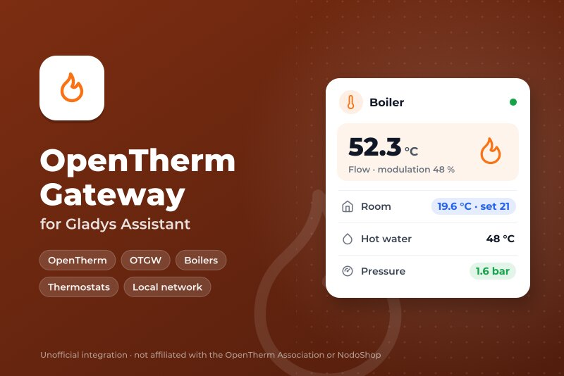
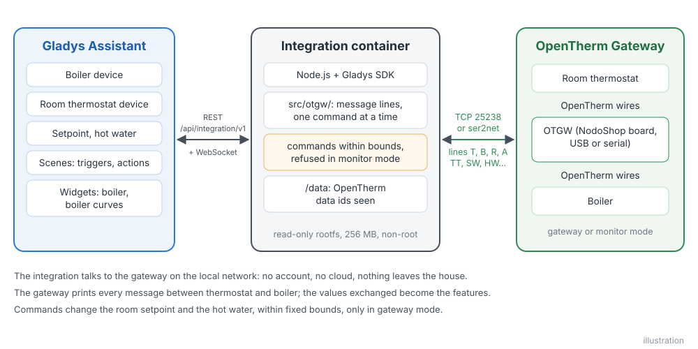
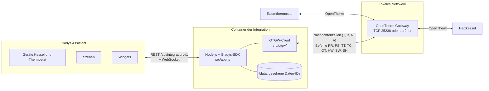
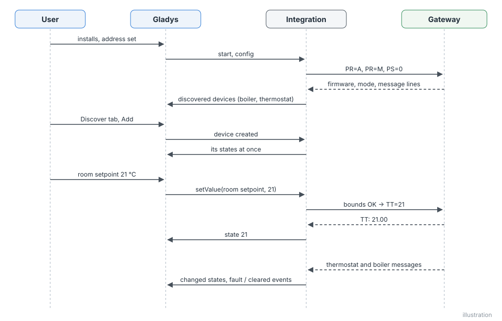
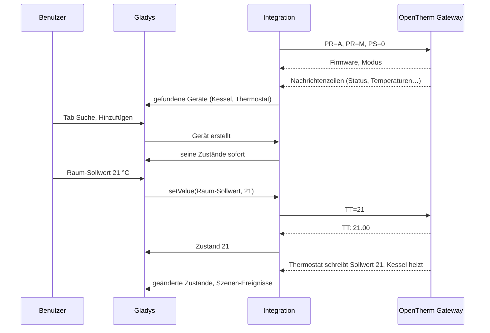
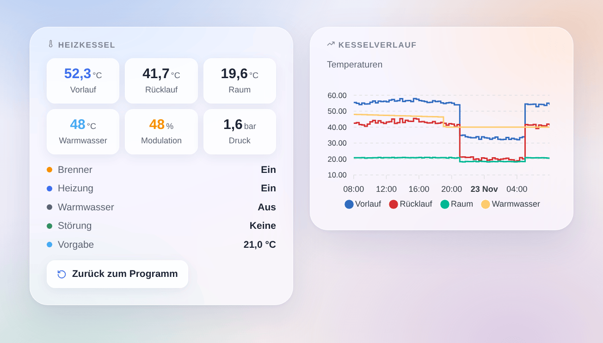
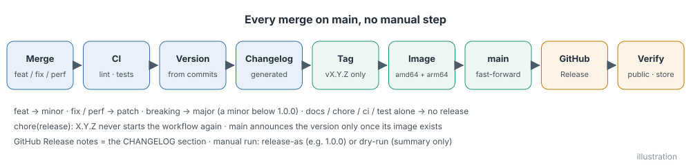

# OpenTherm Gateway für Gladys Assistant

[English](README.md) | [Français](README.fr.md) | **Deutsch** | [Español](README.es.md)

[](LICENSE)
[](https://github.com/William-De71/gladys-opentherm-gateway/releases)
[](https://github.com/William-De71/gladys-opentherm-gateway/actions/workflows/release.yml)
[](https://gladysassistant.com)



Ihr OpenTherm-Heizkessel und Ihr Raumthermostat in Gladys Assistant, über das [OpenTherm Gateway](https://otgw.tclcode.com/) (OTGW) an den zwei Drähten zwischen beiden, in Ihrem lokalen Netzwerk. Gladys sieht, was sie miteinander austauschen (Flamme, Temperaturen, Modulation, Druck, Störungen), kann einen Raum-Sollwert vorgeben, die Außentemperatur senden und das Warmwasser steuern. Inoffiziell, nicht mit der OpenTherm Association, NodoShop oder den Kesselmarken verbunden.

## Funktionen

- **Spricht mit dem Gateway im lokalen Netzwerk**, über seine auf TCP weitergeleitete serielle Schnittstelle: den „Legacy TCP port 25238“ einer NodoShop-OTGW-Platine (OTGW-firmware) oder ser2net für ein USB- oder serielles Gateway.
- **Ein Gerät Heizkessel und ein Gerät Raumthermostat**, deren Funktionen die OpenTherm-Werte sind, die Thermostat und Kessel wirklich austauschen: ein Kessel ohne Drucksensor bekommt keine Druckfunktion, ein neu gesehener Wert fügt seine Funktion hinzu.
- **Live-Werte**: Flamme, Heiz- und Warmwasserbetrieb und Störung erreichen Gladys sofort; Temperaturen, Modulation und Druck höchstens alle 15 Sekunden, gerundet.
- **Raum-Sollwert aus Gladys** (bis zur nächsten Programmänderung des Thermostats oder bis zur Aufhebung), **Warmwasser-Solltemperatur** und **Warmwasser Ein / Aus**; im Monitor-Modus abgelehnt.
- **Zwei Dashboard-Widgets**: der Kessel auf einen Blick (mit einer Schaltfläche, um den Thermostat wieder seinem Programm folgen zu lassen), Temperaturkurven.
- **Sechs Szenen-Auslöser** (Kesselstörung, Störung behoben, Wartung angefordert, Thermostat getrennt, Gateway verloren, Gateway wieder da) und **sechs Szenen-Aktionen** (Sollwert vorgeben oder aufheben, Außentemperatur senden oder nicht mehr senden, Warmwasser, maximale Vorlauftemperatur).
- Englisch, Französisch, Deutsch und Spanisch.

## Funktionsweise





**Protokoll.** Das Gateway schreibt eine Zeile pro OpenTherm-Nachricht: einen Buchstaben (`T` Thermostat, `B` Kessel, `R` / `A` eine vom Gateway geänderte Anfrage oder Antwort) und die 4 Bytes der Nachricht in Hexadezimal (`B40193480`: der Kessel antwortet, dass die Vorlauftemperatur 52,5 °C beträgt). Es nimmt Befehle aus zwei Buchstaben an (`TT=20.5`) und antwortet `TT: 20.50` oder mit einem Fehlercode (`NG`, `SE`, `BV`, `OR`…). Bei jeder Verbindung liest die Integration die Firmware (`PR=A`), den Modus (`PR=M`: Gateway oder Monitor) und verlangt eine Zeile pro Nachricht (`PS=0`).

**Suche.** Die OpenTherm-Daten-IDs, auf die der Kessel antwortet oder die der Thermostat schreibt (Status, Vorlauftemperatur, Modulation, Druck, Raumtemperatur…), bilden die Funktionen der zwei Geräte. Sie werden in `/data/seen.json` gehalten, damit ein Neustart die Geräte nicht verkleinert, bevor der Verkehr zurückkommt. Eine zum ersten Mal gesehene ID wird im Tab Suche angeboten („Aktualisieren“).

**Befehle.** Der Raum-Sollwert nutzt die Fernübersteuerung des Thermostats (`TT` vorübergehend oder `TC` dauerhaft, 5–30 °C, in Schritten von 0,5 °C), die Warmwasser-Solltemperatur `SW` (35–70 °C) und Warmwasser Ein / Aus `HW`. `SW` und `SH` werden im Speicher des Gateways gehalten: derselbe Wert wird nie zweimal gesendet, und höchstens eine Änderung pro Minute.





### Geräte und Funktionen

| Gladys-Gerät                   | Funktionen (wenn die Daten-ID gesehen wird)                                                                                                                                                                                                                                                                                   |
| ------------------------------ | ----------------------------------------------------------------------------------------------------------------------------------------------------------------------------------------------------------------------------------------------------------------------------------------------------------------------------- |
| `boiler:otgw` — Heizkessel     | Flamme, Heizbetrieb, Warmwasserbereitung, Störung (Ein / Aus), Störungsdetails (Text), Modulation (%), Vorlauf-, Rücklauf-, Warmwasser-, Außen- und Abgastemperatur, angeforderte und maximale Vorlauftemperatur (°C), Wasserdruck (bar), Starts und Stunden von Brenner und Pumpen; Warmwasser-Soll und Ein / Aus (änderbar) |
| `thermostat:otgw` — Thermostat | Raumtemperatur, Raum-Sollwert (änderbar), Sollwert von Gladys vorgegeben (Ein / Aus)                                                                                                                                                                                                                                          |

Verwendete Daten-IDs (OpenTherm 2.2): 0 Status, 1 Vorlauf-Sollwert, 5 Störungsflags und Code, 9 Übersteuerungs-Sollwert, 16 Raum-Sollwert, 17 Modulation, 18 Druck, 24 Raumtemperatur, 25 Vorlauf, 26 Warmwasser, 27 Außen, 28 Rücklauf, 33 Abgas, 56 Warmwasser-Soll, 57 maximaler Vorlauf-Sollwert, 116–123 Starts und Stunden. Externe IDs: `ext:<selector>:boiler:otgw:<Schlüssel>`, `ext:<selector>:thermostat:otgw:<Schlüssel>`.

## Transport

`transports: ["local"]`: der Katalog zeigt das Abzeichen **lokal**. Nichts verlässt das lokale Netzwerk: kein Konto, keine Cloud. Jedes Gerät meldet **lokal**, solange das Gateway antwortet, sonst **nicht erreichbar**; es gibt keine lokale Präferenz zu wählen und keinen eingeschränkten Modus.

## Widgets



- **Heizkessel**: Vorlauf-, Rücklauf-, Raum- und Warmwassertemperatur, Modulation, Druck (die Kacheln folgen live den Gerätezuständen), dann die Störung, Brenner, Heizung und Warmwasser, der von Gladys vorgegebene Sollwert mit einer Schaltfläche **Zurück zum Programm**, ein getrennter Thermostat, der Monitor-Modus.
- **Kesselverlauf**: Vorlauf-, Rücklauf-, Raum- und Warmwassertemperatur über 24 Stunden, 3 oder 7 Tage (sobald die Geräte hinzugefügt sind).

## Szenen-Auslöser und -Aktionen

| Auslöser                  | Wann                                               | Daten                                                                                                               |
| ------------------------- | -------------------------------------------------- | ------------------------------------------------------------------------------------------------------------------- |
| `boiler_fault`            | das Störungsbit des Kessels geht an                | `oem_fault_code`, `faults`, `low_water_pressure`, `gas_flame_fault`, `air_pressure_fault`, `water_over_temperature` |
| `boiler_fault_cleared`    | das Störungsbit geht aus                           | `oem_fault_code`                                                                                                    |
| `service_requested`       | der Kessel setzt sein Wartungsanforderungs-Flag    | `oem_fault_code`                                                                                                    |
| `thermostat_disconnected` | das Gateway sieht keinen OpenTherm-Thermostat mehr | `address`                                                                                                           |
| `gateway_offline`         | 3 Minuten lang keine Verbindung zum Gateway        | `address`                                                                                                           |
| `gateway_online`          | das Gateway antwortet wieder                       | `address`                                                                                                           |

| Aktion                      | Was sie tut                                                                              | Ausgaben |
| --------------------------- | ---------------------------------------------------------------------------------------- | -------- |
| `set_room_override`         | gibt einen Raum-Sollwert vor (5–30 °C), bis zur nächsten Programmänderung oder Aufhebung | `result` |
| `cancel_room_override`      | lässt den Thermostat wieder seinem Programm folgen                                       | `result` |
| `set_outside_temperature`   | teilt dem Thermostat die Außentemperatur mit (−40 bis 64 °C)                             | `result` |
| `clear_outside_temperature` | hört damit auf                                                                           | `result` |
| `set_hot_water`             | Warmwasser ein, aus oder wie der Thermostat entscheidet                                  | `result` |
| `set_max_flow_temperature`  | maximale Vorlauftemperatur (20–90 °C, 0 = Thermostat), höchstens einmal pro Minute       | `result` |

Beispiele:

- Wenn der Kessel eine Störung meldet → eine Nachricht mit `{{triggerEvent.data.oem_fault_code}}` und `{{triggerEvent.data.faults}}` senden.
- Wenn sich der Außenfühler von Gladys ändert → die Außentemperatur senden, für die witterungsgeführte Regelung des Thermostats.
- Wenn alle gehen → 17 °C bis zur Aufhebung vorgeben; wenn jemand zurückkommt → den Thermostat wieder seinem Programm folgen lassen.

## Voraussetzungen

- Gladys Assistant **5.3.0 oder neuer** (Katalog-Schlüsselwörter von Gladys 5.3, Dashboard-Widgets sowie Szenen-Auslöser und -Aktionen von Integrationen; ältere Instanzen können die Integration nicht installieren).
- Ein [OpenTherm Gateway](https://otgw.tclcode.com/) zwischen einem OpenTherm-Raumthermostat und einem OpenTherm-Kessel, per TCP erreichbar: eine NodoShop-OTGW-Platine mit eingeschaltetem „Legacy TCP port 25238“ auf ihrer Webseite, oder ein USB- / serielles Gateway, das ser2net im raw-Modus freigibt.
- Für den Raum-Sollwert: ein Thermostat, der die Fernübersteuerung unterstützt (die meisten modulierenden OpenTherm-Thermostate), und das Gateway im Gateway-Modus (`GW=1`).

## Installation

- **Aus dem Store**: Integrationen → „OpenTherm“ suchen → Installieren.
- **Über die URL des Repositorys**: Integrationen → Integration installieren → `https://github.com/William-De71/gladys-opentherm-gateway` einfügen.
- **Entwicklermodus**: Integrationen → Integration installieren → Entwicklermodus, mit dem Manifest eines Builds (die Zusammenfassung des Workflows „Build and publish image“ zeigt es).

## Konfiguration

| Feld            | Typ     | Standard    | Bedeutung                                                                                                                 |
| --------------- | ------- | ----------- | ------------------------------------------------------------------------------------------------------------------------- |
| `host`          | string  | leer        | IP-Adresse oder Name der OTGW-Platine oder des ser2net-Rechners (nicht `localhost`), `:port` und `socket://` erlaubt      |
| `port`          | number  | `25238`     | TCP-Port der seriellen Weiterleitung                                                                                      |
| `override_mode` | select  | `temporary` | Raum-Sollwert aus Gladys: `temporary` (bis zur nächsten Programmänderung, `TT`) oder `constant` (bis zur Aufhebung, `TC`) |
| `language`      | select  | `en`        | Sprache der Geräte- und Funktionsnamen, des Störungstexts und der Szenenfehler                                            |
| `debug_logs`    | boolean | `false`     | ausführliches Log: jeder an das Gateway gesendete Befehl und seine Antwort                                                |

Schaltfläche der Konfigurationsseite: **Gateway testen** (verbindet sich, liest Firmware und Modus, listet die gesehenen OpenTherm-Werte).

## Verwendung

1. Schalten Sie die serielle TCP-Schnittstelle des Gateways ein (OTGW-firmware: „Legacy TCP port 25238“; oder ser2net).
2. Installieren Sie die Integration, geben Sie die Adresse des Gateways ein und drücken Sie **Gateway testen**.
3. Fügen Sie Kessel und Thermostat im Tab **Suche** hinzu, die Widgets einem Dashboard, und erstellen Sie Ihre Szenen.

Die Benutzerdokumentation steht in [docs/de.md](docs/de.md) ([en](docs/en.md), [fr](docs/fr.md), [es](docs/es.md)).

## Grenzen

- **Nie an einem echten Gateway getestet**: alles wird gegen ein falsches Gateway auf einem echten lokalen Socket getestet, das der Firmware-Dokumentation folgt. Rückmeldungen willkommen, mit den Zeilen des ausführlichen Logs.
- Die Werte hängen davon ab, was Ihr Thermostat beim Kessel abfragt: ein nie ausgetauschter Wert erscheint nie (die im Speicher des Gateways gehaltenen „alternativen“ IDs werden nicht genutzt).
- Ein Gateway pro Integration (das OpenTherm-Protokoll identifiziert weder Thermostat noch Kessel). Lüftung, Solarspeicher und zweiter Heizkreis werden nicht unterstützt.
- Die OTGW-firmware nimmt auf ihrem TCP-Port eventuell nur einen Client an: gleichzeitig verbundenes OTmonitor oder Home Assistant kann ihn belegen.

## Lokale Entwicklung

```bash
npm install
GLADYS_HOST_API_URL=http://localhost:1443 \
  GLADYS_INTEGRATION_TOKEN=… GLADYS_INTEGRATION_SELECTOR=… \
  OTGW_DATA_DIR=./data DEBUG=gladys-integration-sdk node index.js
```

| Variable                                                                         | Standard           | Zweck                                     |
| -------------------------------------------------------------------------------- | ------------------ | ----------------------------------------- |
| `GLADYS_HOST_API_URL`, `GLADYS_INTEGRATION_TOKEN`, `GLADYS_INTEGRATION_SELECTOR` | von Gladys gesetzt | Verbindung zur Host-API von Gladys        |
| `OTGW_DATA_DIR`                                                                  | `/data`            | Ordner von `seen.json`                    |
| `DEBUG`                                                                          | nicht gesetzt      | `gladys-integration-sdk` für die SDK-Logs |

| Skript                            | Was es tut                                           |
| --------------------------------- | ---------------------------------------------------- |
| `npm test`                        | die Tests (`node --test`), nichts verlässt 127.0.0.1 |
| `npm run lint`                    | ESLint                                               |
| `npm run format` / `format:check` | Prettier                                             |
| `docs/illustrations/render.sh`    | erzeugt die Widget-Illustrationen neu                |
| `scripts/build-cover.sh`          | erzeugt `cover.jpg` aus `docs/assets/cover.svg` neu  |

## Tests

`npm test` lässt die ganze Integration gegen das falsche Gladys des SDK und ein falsches OpenTherm Gateway auf einem echten lokalen Socket laufen. Abgedeckt: das Protokoll (Nachrichtenzeilen, Paritätsbit, Antworten, Fehlercodes, Ereignisse, f8.8 / s16 / u16), welche Zeilen einen Wert tragen, die Funktionen der gesehenen Daten-IDs, der Client (ein Befehl nach dem anderen, Zeitlimits und 3 Versuche, `OE`, Wiederverbindung), die Identifikation, die Suche und ihre gespeicherten IDs, abgetastete und sofortige Zustände, jeder Befehl und seine Grenzen (Monitor-Modus, Abstand, gleicher Wert), Szenen-Auslöser und -Aktionen mit ihren deklarierten Daten und Ausgaben, die zwei Widgets, geprüft mit `validateWidgetContent`, und die Widget-Schaltfläche, das Gateway verloren und wieder da. Das Manifest wird gegen den Code, die Übersetzungen und das Release-Skript geprüft. Die CI baut außerdem das Image und startet es wie Gladys (schreibgeschützt, 256 MB, ohne Netzwerk).

## Release-Prozess

Jeder Merge auf `main` veröffentlicht eine Version, wenn seine Commits es rechtfertigen, ohne manuellen Schritt:

```mermaid
flowchart LR
  A[Merge auf main] --> B[CI: Prettier, ESLint,<br/>Tests, Docker-Build]
  B --> C[nächste Version aus den<br/>Conventional Commits]
  C --> D[Abschnitt in CHANGELOG.md]
  D --> E[Commit chore release<br/>+ Tag vX.Y.Z]
  E --> F[Image :X.Y.Z + :latest<br/>amd64 + arm64]
  F --> G[main rückt auf den<br/>Release-Commit vor]
  G --> H[GitHub Release]
  H --> I[Prüfung: anonymer Pull,<br/>Store-Validator, Topic]
```





- `feat` → Minor, `fix` / `perf` → Patch, `!` oder `BREAKING CHANGE:` → Major (unter 1.0.0 ein Minor). `docs`, `chore`, `ci`, `test`, `style`, `refactor`, `build` allein veröffentlichen nichts.
- Der Titel des Pull Requests wird zum Squash-Commit, also zur Zeile im Changelog: auf Englisch, für den Benutzer schreiben (`feat(widgets): …`). `pr-title.yml` prüft ihn. `CHANGELOG.md` nie von Hand bearbeiten.
- Das Image existiert, bevor `main` seine Version ankündigt (der Store indexiert `main`).
- 1.0.0 ist eine manuelle Entscheidung: Actions → Release → Run workflow, `release-as: 1.0.0`. `dry-run` zeigt Version und Changelog, ohne zu veröffentlichen.
- **Geschützter Branch**: Rulesets verlangen einen Pull Request auf `main` und sperren die `v*`-Tags; nur der Maintainer und Deploy Keys kommen durch. Das Release pusht mit dem Deploy Key der Umgebung `release` (Secret `RELEASE_DEPLOY_KEY`, nur `main`): Ein Lauf von einem anderen Branch erhält ihn nie. `build.yml` und `github-release.yml` starten nicht bei einem Tag: Das Release ruft sie auf, oder starten Sie sie von Hand (Actions → Run workflow, mit `version` für das Image), um ein Release abzuschließen.
- Nach dem ersten Release das Paket bei Bedarf öffentlich machen: Package settings → Change visibility → Public.

## Fehlerbehebung

- **„Das Gateway antwortet nicht“**: Adresse und Port prüfen; auf einer NodoShop-Platine „Legacy TCP port 25238“ einschalten; `localhost` funktioniert aus dem Container der Integration nicht; OTmonitor oder ein anderes Programm kann die einzige Verbindung belegen.
- **„Unter … antwortet etwas, aber kein OpenTherm Gateway“**: falscher Port (die Webseite auf 80, das Telnet-Log auf 23) oder ser2net nicht im raw-Modus.
- **„Warte auf den OpenTherm-Verkehr“**: der Thermostat ist nicht am Gateway angeschlossen, der Kessel ist aus, oder der Thermostat ist ein Ein/Aus-Modell (kein OpenTherm).
- **„Monitor-Modus“**: das Gateway hört nur zu; stellen Sie es auf den Gateway-Modus (`GW=1`, aus OTmonitor oder der OTGW-Webseite), um Einstellungen zu ändern.
- **Der Sollwert springt zurück**: der Thermostat unterstützt die Fernübersteuerung nicht, oder ein vorübergehender Sollwert endete bei der nächsten Programmänderung (wählen Sie „Bis zur Aufhebung“).
- **Ein Wert fehlt**: Ihr Thermostat fragt ihn beim Kessel nie ab.
- Logs: der Tab Logs der Integration. Sie melden immer den Verlust des Gateways (mit Grund), was gefunden wurde und jeden angenommenen Befehl; **Ausführliches Log** zeigt zusätzlich jeden Befehl und seine Antwort. `DEBUG=gladys-integration-sdk` für die Details des SDK.

## Mitwirken

Issues und Pull Requests sind willkommen. Führen Sie `npm run format:check`, `npm run lint` und `npm test` aus, schreiben Sie den Titel des Pull Requests als Conventional Commit, und starten Sie `docs/illustrations/render.sh` nach jeder Änderung eines Widget-Inhalts neu. Ändern Sie nie den Schlüssel einer bestehenden Funktion oder ihre Gladys-Felder. Wenn sich eine echte Installation anders verhält, fügen Sie zuerst ihre Zeilen (ausführliches Log) den Tests hinzu und korrigieren Sie dann den Code.

## Sicherheit

Siehe [SECURITY.md](SECURITY.md). Die serielle Schnittstelle des Gateways auf TCP hat keine Authentifizierung: halten Sie sie in einem vertrauenswürdigen Netzwerk, nie dem Internet ausgesetzt. Die Integration sendet nur die Befehle, die sie dokumentiert, mit geprüften Werten. `/data` hält nur die Liste der gesehenen Daten-IDs.

## Lizenz

[Apache License 2.0](LICENSE), siehe auch [NOTICE](NOTICE). Der Client wurde für dieses Projekt nach der Firmware-Dokumentation des OpenTherm Gateway (Schelte Bron) und dem Nachrichtenformat von OpenTherm 2.2 geschrieben; kein Code wurde kopiert. OpenTherm ist eine Marke der OpenTherm Association; dieses Projekt ist weder mit ihr, Schelte Bron, NodoShop noch einer Kessel- oder Thermostatmarke verbunden, von ihnen gebilligt oder unterstützt.
