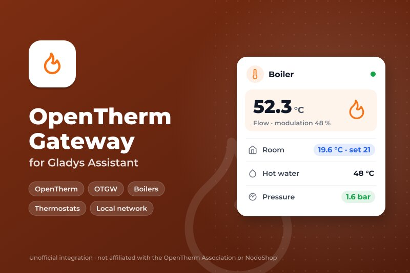
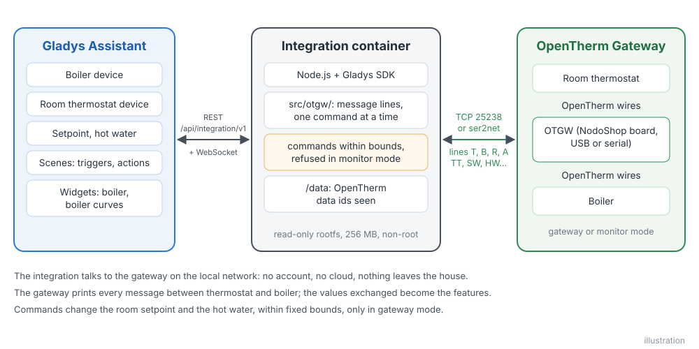
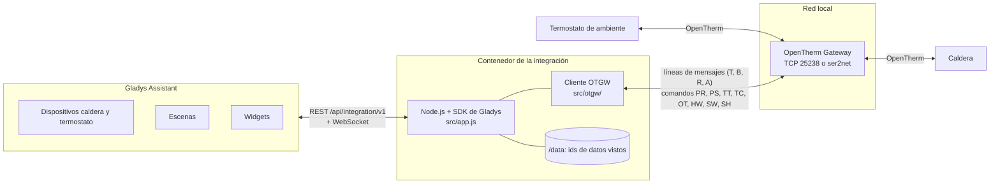
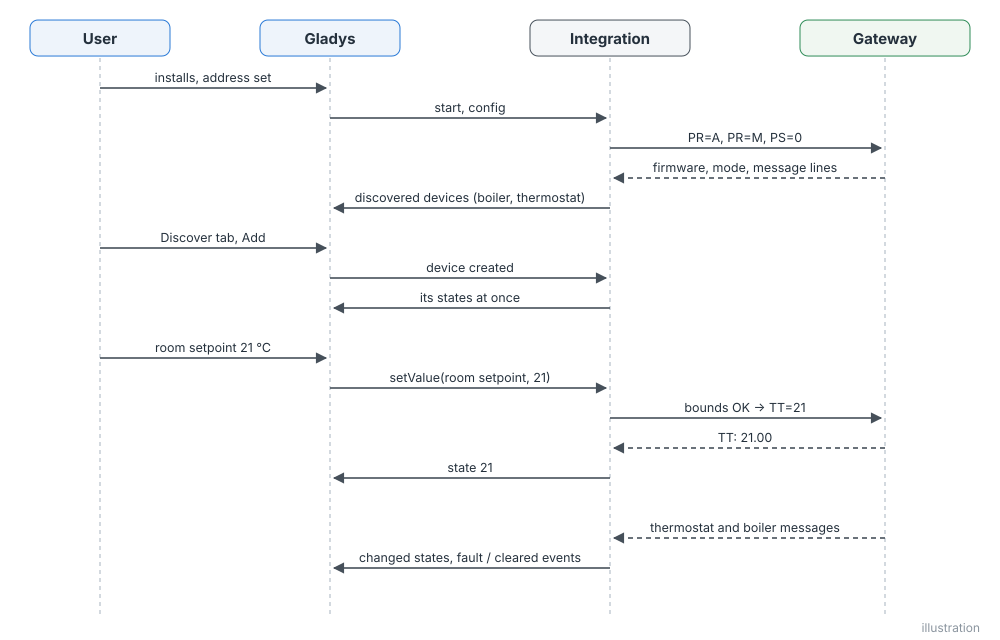
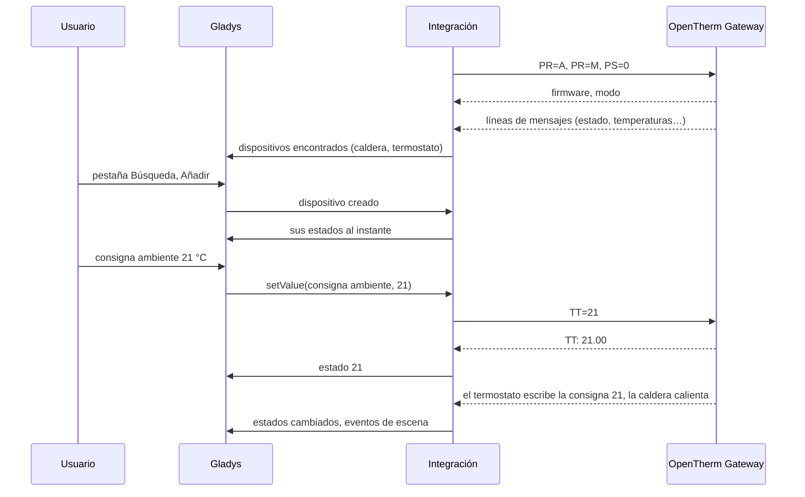
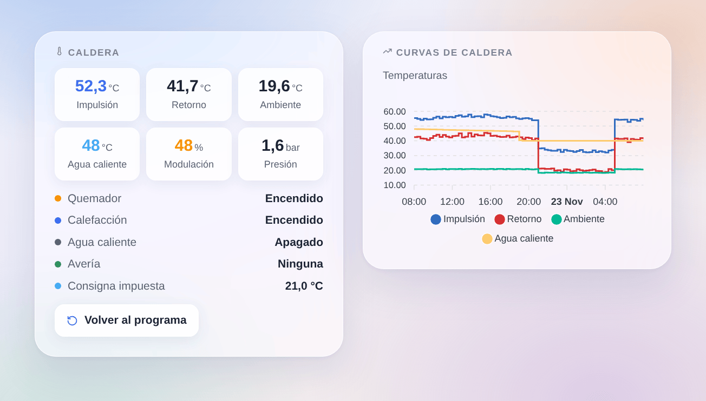
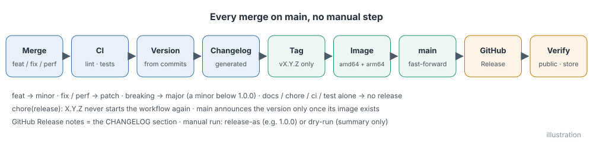

# OpenTherm Gateway para Gladys Assistant

[English](README.md) | [Français](README.fr.md) | [Deutsch](README.de.md) | **Español**

[](LICENSE)
[](https://github.com/William-De71/gladys-opentherm-gateway/releases)
[](https://github.com/William-De71/gladys-opentherm-gateway/actions/workflows/release.yml)
[](https://gladysassistant.com)



Su caldera y su termostato de ambiente OpenTherm en Gladys Assistant, gracias al [OpenTherm Gateway](https://otgw.tclcode.com/) (OTGW) conectado a los dos cables que los unen, en su red local. Gladys ve lo que se dicen (llama, temperaturas, modulación, presión, averías), puede imponer una consigna ambiente, enviar la temperatura exterior y controlar el agua caliente. No oficial, sin relación con la OpenTherm Association, NodoShop ni las marcas de calderas.

## Funciones

- **Dialoga con la pasarela en la red local**, por su puerto serie redirigido a TCP: el «Legacy TCP port 25238» de una placa OTGW de NodoShop (OTGW-firmware), o ser2net para una pasarela USB o serie.
- **Un dispositivo caldera y un dispositivo termostato de ambiente**, cuyas funciones son los valores OpenTherm que su termostato y su caldera intercambian de verdad: una caldera sin sensor de presión no tiene función de presión, un valor nuevo añade su función.
- **Valores en directo**: llama, calefacción, agua caliente y avería llegan a Gladys al instante; temperaturas, modulación y presión como mucho cada 15 segundos, redondeadas.
- **Consigna ambiente desde Gladys** (hasta el próximo cambio de programa del termostato, o hasta que se anule), **consigna de agua caliente** y **agua caliente encendida / apagada**; rechazadas en modo monitor.
- **Dos widgets**: la caldera de un vistazo (con un botón para devolver el termostato a su programa), las curvas de temperatura.
- **Seis disparadores de escena** (avería de la caldera, avería resuelta, mantenimiento pedido, termostato desconectado, pasarela perdida, pasarela de vuelta) y **seis acciones de escena** (imponer o anular una consigna, enviar o dejar de enviar la temperatura exterior, agua caliente, temperatura de impulsión máxima).
- Inglés, francés, alemán y español.

## Cómo funciona





**Protocolo.** La pasarela escribe una línea por mensaje OpenTherm: una letra (`T` termostato, `B` caldera, `R` / `A` una petición o una respuesta modificada por la pasarela) y los 4 bytes del mensaje en hexadecimal (`B40193480`: la caldera responde que la temperatura de impulsión es de 52,5 °C). Acepta comandos de dos letras (`TT=20.5`) y responde `TT: 20.50`, o un código de error (`NG`, `SE`, `BV`, `OR`…). En cada conexión, la integración lee el firmware (`PR=A`), el modo (`PR=M`: pasarela o monitor) y pide una línea por mensaje (`PS=0`).

**Búsqueda.** Los identificadores de datos OpenTherm a los que responde la caldera o que escribe el termostato (estado, temperatura de impulsión, modulación, presión, temperatura ambiente…) forman las funciones de los dos dispositivos. Se guardan en `/data/seen.json`, para que un reinicio no reduzca los dispositivos antes de que vuelva el tráfico. Un identificador visto por primera vez se ofrece en la pestaña Búsqueda («Actualizar»).

**Comandos.** La consigna ambiente usa la anulación remota del termostato (`TT` temporal o `TC` permanente, 5–30 °C, en pasos de 0,5 °C), la consigna de agua caliente `SW` (35–70 °C) y el agua caliente encendida / apagada `HW`. `SW` y `SH` se guardan en la memoria de la pasarela: el mismo valor nunca se envía dos veces, y como mucho un cambio por minuto.





### Dispositivos y funciones

| Dispositivo de Gladys          | Funciones (cuando se ve el identificador)                                                                                                                                                                                                                                                                                                                                                |
| ------------------------------ | ---------------------------------------------------------------------------------------------------------------------------------------------------------------------------------------------------------------------------------------------------------------------------------------------------------------------------------------------------------------------------------------- |
| `boiler:otgw` — Caldera        | llama, calefacción activa, agua caliente activa, avería (encendido / apagado), detalle de la avería (texto), modulación (%), temperaturas de impulsión, retorno, agua caliente, exterior y de humos, consigna de impulsión pedida y máxima (°C), presión del agua (bar), arranques y horas del quemador y de las bombas; consigna y encendido / apagado del agua caliente (modificables) |
| `thermostat:otgw` — Termostato | temperatura ambiente, consigna ambiente (modificable), consigna impuesta por Gladys (encendido / apagado)                                                                                                                                                                                                                                                                                |

Identificadores usados (OpenTherm 2.2): 0 estado, 1 consigna de impulsión, 5 indicadores y código de avería, 9 consigna de anulación, 16 consigna ambiente, 17 modulación, 18 presión, 24 temperatura ambiente, 25 impulsión, 26 agua caliente, 27 exterior, 28 retorno, 33 humos, 56 consigna de agua caliente, 57 consigna de impulsión máxima, 116–123 arranques y horas. Identificadores externos: `ext:<selector>:boiler:otgw:<clave>`, `ext:<selector>:thermostat:otgw:<clave>`.

## Transporte

`transports: ["local"]`: el catálogo muestra la insignia **local**. Nada sale de la red local: ni cuenta, ni nube. Cada dispositivo publica **local** mientras la pasarela responde, e **inaccesible** si no; no hay preferencia local que elegir ni modo degradado.

## Widgets



- **Caldera**: temperaturas de impulsión, retorno, ambiente y agua caliente, modulación, presión (los mosaicos siguen en directo los estados de los dispositivos), luego la avería, el quemador, la calefacción y el agua caliente, la consigna impuesta por Gladys con un botón **Volver al programa**, un termostato desconectado, el modo monitor.
- **Curvas de caldera**: temperaturas de impulsión, retorno, ambiente y agua caliente en 24 horas, 3 o 7 días (una vez añadidos los dispositivos).

## Disparadores y acciones de escena

| Disparador                | Cuándo                                                      | Datos                                                                                                               |
| ------------------------- | ----------------------------------------------------------- | ------------------------------------------------------------------------------------------------------------------- |
| `boiler_fault`            | el bit de avería de la caldera se activa                    | `oem_fault_code`, `faults`, `low_water_pressure`, `gas_flame_fault`, `air_pressure_fault`, `water_over_temperature` |
| `boiler_fault_cleared`    | el bit de avería se desactiva                               | `oem_fault_code`                                                                                                    |
| `service_requested`       | la caldera activa su indicador de petición de mantenimiento | `oem_fault_code`                                                                                                    |
| `thermostat_disconnected` | la pasarela ya no ve un termostato OpenTherm                | `address`                                                                                                           |
| `gateway_offline`         | ninguna conexión con la pasarela durante 3 minutos          | `address`                                                                                                           |
| `gateway_online`          | la pasarela vuelve a responder                              | `address`                                                                                                           |

| Acción                      | Qué hace                                                                                  | Salidas  |
| --------------------------- | ----------------------------------------------------------------------------------------- | -------- |
| `set_room_override`         | impone una consigna ambiente (5–30 °C), hasta el próximo cambio de programa o anulación   | `result` |
| `cancel_room_override`      | devuelve el termostato a su programa                                                      | `result` |
| `set_outside_temperature`   | indica al termostato la temperatura exterior (−40 a 64 °C)                                | `result` |
| `clear_outside_temperature` | deja de indicarla                                                                         | `result` |
| `set_hot_water`             | agua caliente encendida, apagada, o según el termostato                                   | `result` |
| `set_max_flow_temperature`  | temperatura de impulsión máxima (20–90 °C, 0 = termostato), como mucho una vez por minuto | `result` |

Ejemplos:

- Cuando la caldera indica una avería → enviar un mensaje con `{{triggerEvent.data.oem_fault_code}}` y `{{triggerEvent.data.faults}}`.
- Cuando cambia la sonda exterior de Gladys → enviar la temperatura exterior, para la regulación climática del termostato.
- Cuando todos se van → imponer 17 °C hasta que se anule; cuando alguien vuelve → devolver el termostato a su programa.

## Requisitos

- Gladys Assistant **5.3.0 o posterior** (palabras clave del catálogo de Gladys 5.3, widgets, disparadores y acciones de escena de las integraciones; las instancias más antiguas no pueden instalar la integración).
- Un [OpenTherm Gateway](https://otgw.tclcode.com/) conectado entre un termostato de ambiente OpenTherm y una caldera OpenTherm, accesible por TCP: una placa OTGW de NodoShop con «Legacy TCP port 25238» activado en su página web, o una pasarela USB / serie compartida con ser2net en modo raw.
- Para la consigna ambiente: un termostato que admita la anulación remota (la mayoría de los termostatos OpenTherm modulantes), y la pasarela en modo pasarela (`GW=1`).

## Instalación

- **Desde la tienda**: Integraciones → buscar «OpenTherm» → Instalar.
- **Desde la URL del repositorio**: Integraciones → Instalar una integración → pegar `https://github.com/William-De71/gladys-opentherm-gateway`.
- **Modo desarrollador**: Integraciones → Instalar una integración → Modo desarrollador, con el manifiesto de un build (el resumen del workflow «Build and publish image» lo muestra).

## Configuración

| Campo           | Tipo    | Por defecto | Significado                                                                                                                     |
| --------------- | ------- | ----------- | ------------------------------------------------------------------------------------------------------------------------------- |
| `host`          | string  | vacío       | dirección IP o nombre de la placa OTGW o del equipo con ser2net (no `localhost`), se aceptan `:puerto` y `socket://`            |
| `port`          | number  | `25238`     | puerto TCP de la redirección serie                                                                                              |
| `override_mode` | select  | `temporary` | consigna ambiente desde Gladys: `temporary` (hasta el próximo cambio de programa, `TT`) o `constant` (hasta que se anule, `TC`) |
| `language`      | select  | `en`        | idioma de los nombres de dispositivos y funciones, del texto de avería y de los errores de escena                               |
| `debug_logs`    | boolean | `false`     | registro detallado: cada comando enviado a la pasarela y su respuesta                                                           |

Botón de la página de configuración: **Probar la pasarela** (se conecta, lee el firmware y el modo, lista los valores OpenTherm vistos).

## Uso

1. Active el puerto serie TCP de la pasarela (OTGW-firmware: «Legacy TCP port 25238»; o ser2net).
2. Instale la integración, escriba la dirección de la pasarela y pulse **Probar la pasarela**.
3. Añada la caldera y el termostato desde la pestaña **Búsqueda**, los widgets a un panel, y cree sus escenas.

La documentación de usuario está en [docs/es.md](docs/es.md) ([en](docs/en.md), [fr](docs/fr.md), [de](docs/de.md)).

## Límites

- **Nunca probada con una pasarela real**: todo se prueba contra una pasarela falsa en un socket local real, que sigue la documentación del firmware. Se agradecen comentarios, con las líneas del registro detallado.
- Los valores dependen de lo que su termostato pide a la caldera: un valor nunca intercambiado nunca aparece (los identificadores «alternativos» de la pasarela, guardados en su memoria, no se usan).
- Una pasarela por integración (el protocolo OpenTherm no identifica ni el termostato ni la caldera). La ventilación, el almacenamiento solar y el segundo circuito de calefacción no se gestionan.
- El OTGW-firmware puede aceptar un solo cliente en su puerto TCP: OTmonitor o Home Assistant conectados a la vez pueden ocuparlo.

## Desarrollo local

```bash
npm install
GLADYS_HOST_API_URL=http://localhost:1443 \
  GLADYS_INTEGRATION_TOKEN=… GLADYS_INTEGRATION_SELECTOR=… \
  OTGW_DATA_DIR=./data DEBUG=gladys-integration-sdk node index.js
```

| Variable                                                                         | Por defecto        | Uso                                            |
| -------------------------------------------------------------------------------- | ------------------ | ---------------------------------------------- |
| `GLADYS_HOST_API_URL`, `GLADYS_INTEGRATION_TOKEN`, `GLADYS_INTEGRATION_SELECTOR` | fijadas por Gladys | conexión con la API anfitriona de Gladys       |
| `OTGW_DATA_DIR`                                                                  | `/data`            | carpeta de `seen.json`                         |
| `DEBUG`                                                                          | sin definir        | `gladys-integration-sdk` para los logs del SDK |

| Script                            | Qué hace                                            |
| --------------------------------- | --------------------------------------------------- |
| `npm test`                        | las pruebas (`node --test`), nada sale de 127.0.0.1 |
| `npm run lint`                    | ESLint                                              |
| `npm run format` / `format:check` | Prettier                                            |
| `docs/illustrations/render.sh`    | regenera las ilustraciones de los widgets           |
| `scripts/build-cover.sh`          | regenera `cover.jpg` desde `docs/assets/cover.svg`  |

## Pruebas

`npm test` ejecuta toda la integración contra el Gladys falso del SDK y un OpenTherm Gateway falso en un socket local real. Cubierto: el protocolo (líneas de mensajes, bit de paridad, respuestas, códigos de error, eventos, f8.8 / s16 / u16), qué líneas llevan un valor, las funciones de los identificadores vistos, el cliente (un comando a la vez, tiempos de espera y 3 intentos, `OE`, reconexión), la identificación, la búsqueda y sus identificadores guardados, los estados muestreados e inmediatos, cada comando y sus límites (modo monitor, espaciado, mismo valor), los disparadores y acciones de escena con sus datos y salidas declarados, los dos widgets validados por `validateWidgetContent` y el botón del widget, la pasarela perdida y de vuelta. El manifiesto se comprueba contra el código, las traducciones y el script de release. La CI también construye la imagen y la arranca como Gladys (solo lectura, 256 MB, sin red).

## Proceso de release

Cada fusión en `main` publica una versión cuando sus commits lo justifican, sin paso manual:

```mermaid
flowchart LR
  A[fusión en main] --> B[CI: Prettier, ESLint,<br/>pruebas, build Docker]
  B --> C[versión siguiente según<br/>los Conventional Commits]
  C --> D[sección de CHANGELOG.md]
  D --> E[commit chore release<br/>+ tag vX.Y.Z]
  E --> F[imagen :X.Y.Z + :latest<br/>amd64 + arm64]
  F --> G[main avanza al<br/>commit de release]
  G --> H[GitHub Release]
  H --> I[verificación: pull anónimo,<br/>validador de la tienda, topic]
```





- `feat` → menor, `fix` / `perf` → parche, `!` o `BREAKING CHANGE:` → mayor (menor por debajo de 1.0.0). `docs`, `chore`, `ci`, `test`, `style`, `refactor`, `build` solos no publican nada.
- El título de la pull request se convierte en el commit squash, y por tanto en la línea del changelog: escríbalo en inglés, para el usuario (`feat(widgets): …`). `pr-title.yml` lo comprueba. Nunca edite `CHANGELOG.md` a mano.
- La imagen existe antes de que `main` anuncie su versión (la tienda indexa `main`).
- La 1.0.0 es una decisión manual: Actions → Release → Run workflow, `release-as: 1.0.0`. `dry-run` muestra la versión y el changelog sin publicar.
- **Rama protegida**: unos rulesets exigen una pull request en `main` y bloquean las etiquetas `v*`; solo pasan el mantenedor y las deploy keys. La publicación hace push con la deploy key del entorno `release` (secreto `RELEASE_DEPLOY_KEY`, solo `main`): una ejecución lanzada desde otra rama nunca la obtiene. `build.yml` y `github-release.yml` no arrancan con una etiqueta: la publicación los llama, o lánzelos a mano (Actions → Run workflow, con `version` para la imagen) para terminar una publicación.
- Tras la primera release, haga público el paquete si hace falta: Package settings → Change visibility → Public.

## Solución de problemas

- **«La pasarela no responde»**: compruebe la dirección y el puerto; en una placa NodoShop, active «Legacy TCP port 25238»; `localhost` no funciona desde el contenedor de la integración; OTmonitor u otro programa puede ocupar la única conexión.
- **«Algo responde, pero no una OpenTherm Gateway»**: puerto equivocado (la página web en el 80, el registro telnet en el 23), o ser2net no está en modo raw.
- **«Esperando el tráfico OpenTherm»**: el termostato no está conectado a la pasarela, la caldera está apagada, o el termostato es de tipo todo/nada (no OpenTherm).
- **«modo monitor»**: la pasarela solo escucha; pásela a modo pasarela (`GW=1`, desde OTmonitor o la página web del OTGW) para cambiar ajustes.
- **La consigna vuelve**: el termostato no admite la anulación remota, o una consigna temporal terminó en el siguiente cambio de programa (elija «hasta que se anule»).
- **Falta un valor**: su termostato nunca lo pide a la caldera.
- Registros: la pestaña Logs de la integración. Siempre indican la pérdida de la pasarela (con el motivo), lo encontrado y cada comando aceptado; marque **Registro detallado** para ver también cada comando y su respuesta. `DEBUG=gladys-integration-sdk` para los detalles del SDK.

## Contribuir

Issues y pull requests son bienvenidas. Ejecute `npm run format:check`, `npm run lint` y `npm test`, escriba el título de la pull request como Conventional Commit, y vuelva a ejecutar `docs/illustrations/render.sh` tras cualquier cambio en el contenido de un widget. Nunca cambie la clave de una función existente ni sus campos de Gladys. Cuando una instalación real se comporte de otro modo, añada primero sus líneas (registro detallado) a las pruebas y luego corrija el código.

## Seguridad

Vea [SECURITY.md](SECURITY.md). El puerto serie de la pasarela en TCP no tiene autenticación: manténgalo en una red de confianza, nunca expuesto a Internet. La integración solo envía los comandos que documenta, con valores comprobados. `/data` solo guarda la lista de identificadores vistos.

## Licencia

[Licencia Apache 2.0](LICENSE), vea también [NOTICE](NOTICE). El cliente se escribió para este proyecto a partir de la documentación del firmware del OpenTherm Gateway (Schelte Bron) y del formato de mensajes de OpenTherm 2.2; no se copió ningún código. OpenTherm es una marca de la OpenTherm Association; este proyecto no está afiliado, respaldado ni apoyado por ella, por Schelte Bron, NodoShop ni ninguna marca de calderas o termostatos.
