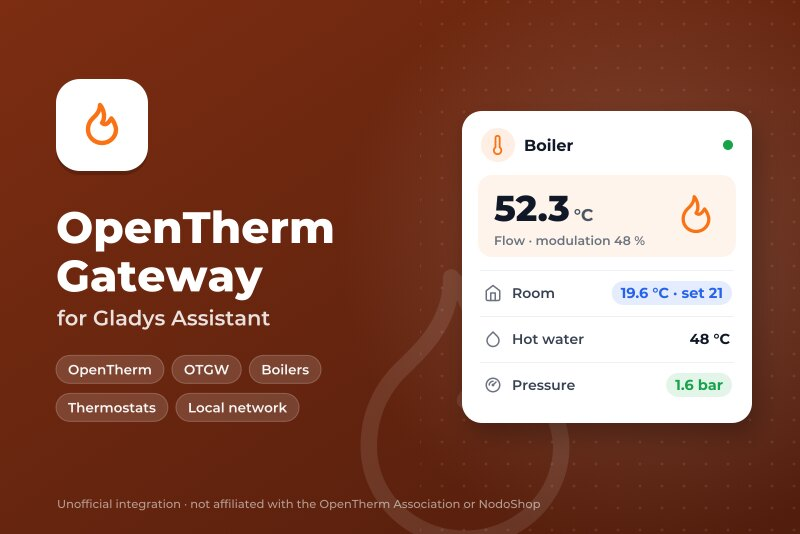
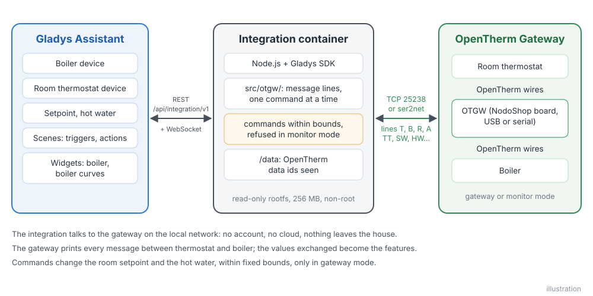
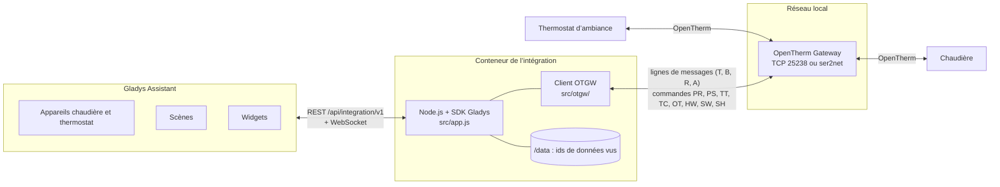
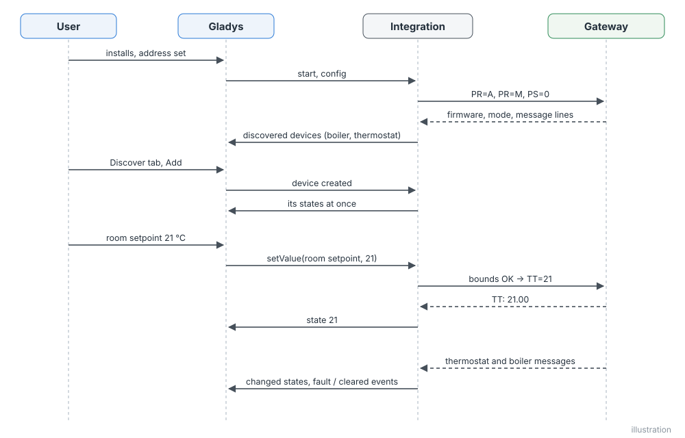
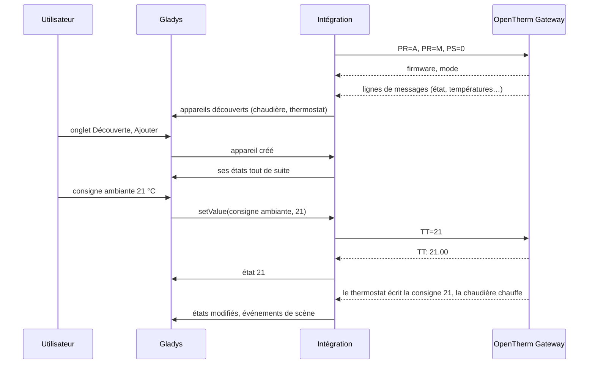
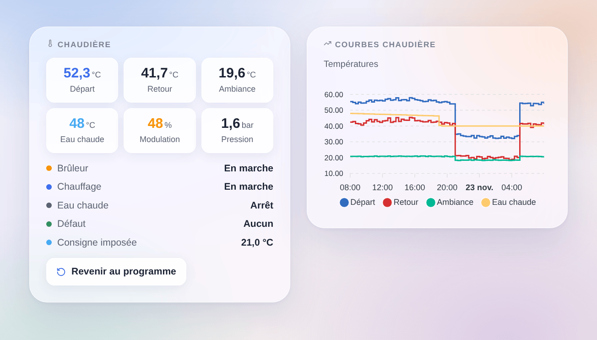
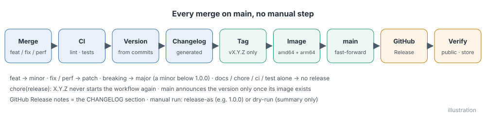

# OpenTherm Gateway pour Gladys Assistant

[English](README.md) | **Français** | [Deutsch](README.de.md) | [Español](README.es.md)

[](LICENSE)
[](https://github.com/William-De71/gladys-opentherm-gateway/releases)
[](https://github.com/William-De71/gladys-opentherm-gateway/actions/workflows/release.yml)
[](https://gladysassistant.com)



Votre chaudière et votre thermostat d’ambiance OpenTherm dans Gladys Assistant, grâce à l’[OpenTherm Gateway](https://otgw.tclcode.com/) (OTGW) branchée sur les deux fils qui les relient, sur votre réseau local. Gladys voit ce qu’ils se disent (flamme, températures, modulation, pression, défauts), peut imposer une consigne ambiante, envoyer la température extérieure et piloter l’eau chaude. Non officielle, sans lien avec l’OpenTherm Association, NodoShop ni les marques de chaudières.

## Fonctionnalités

- **Dialogue avec la passerelle sur le réseau local**, par son port série relayé en TCP : le « Legacy TCP port 25238 » d’une carte OTGW NodoShop (OTGW-firmware), ou ser2net pour une passerelle USB ou série.
- **Un appareil chaudière et un appareil thermostat d’ambiance**, dont les fonctionnalités sont les valeurs OpenTherm que votre thermostat et votre chaudière échangent réellement : une chaudière sans capteur de pression n’a pas de fonctionnalité pression, une nouvelle valeur vue ajoute sa fonctionnalité.
- **Valeurs en direct** : flamme, chauffage, eau chaude et défaut arrivent tout de suite dans Gladys ; températures, modulation et pression au plus toutes les 15 secondes, arrondies.
- **Consigne ambiante depuis Gladys** (jusqu’au prochain changement de programme du thermostat, ou jusqu’à annulation), **consigne d’eau chaude** et **eau chaude marche / arrêt** ; refusées en mode moniteur.
- **Deux widgets** : la chaudière en un coup d’œil (avec un bouton pour rendre la main au programme du thermostat), les courbes de température.
- **Six déclencheurs de scène** (défaut chaudière, défaut disparu, entretien demandé, thermostat déconnecté, passerelle perdue, passerelle revenue) et **six actions de scène** (imposer ou annuler une consigne, envoyer ou arrêter d’envoyer la température extérieure, eau chaude, température de départ maximale).
- Anglais, français, allemand et espagnol.

## Fonctionnement





**Protocole.** La passerelle écrit une ligne par message OpenTherm : une lettre (`T` thermostat, `B` chaudière, `R` / `A` une requête ou une réponse modifiée par la passerelle) et les 4 octets du message en hexadécimal (`B40193480` : la chaudière répond que la température de départ est de 52,5 °C). Elle accepte des commandes de deux lettres (`TT=20.5`) et répond `TT: 20.50`, ou un code d’erreur (`NG`, `SE`, `BV`, `OR`…). À chaque connexion, l’intégration lit le firmware (`PR=A`), le mode (`PR=M` : passerelle ou moniteur) et demande une ligne par message (`PS=0`).

**Découverte.** Les identifiants de données OpenTherm auxquels répond la chaudière ou qu’écrit le thermostat (état, température de départ, modulation, pression, température ambiante…) forment les fonctionnalités des deux appareils. Ils sont gardés dans `/data/seen.json`, pour qu’un redémarrage ne réduise pas les appareils avant le retour des échanges. Un identifiant vu pour la première fois est proposé dans l’onglet Découverte (« Mettre à jour »).

**Commandes.** La consigne ambiante passe par la dérogation à distance du thermostat (`TT` temporaire ou `TC` permanente, 5–30 °C, par pas de 0,5 °C), la consigne d’eau chaude par `SW` (35–70 °C) et l’eau chaude marche / arrêt par `HW`. `SW` et `SH` sont gardés dans la mémoire de la passerelle : la même valeur n’est jamais renvoyée, et une modification par minute au plus.





### Appareils et fonctionnalités

| Appareil Gladys                | Fonctionnalités (quand l’identifiant est vu)                                                                                                                                                                                                                                                                                                                           |
| ------------------------------ | ---------------------------------------------------------------------------------------------------------------------------------------------------------------------------------------------------------------------------------------------------------------------------------------------------------------------------------------------------------------------- |
| `boiler:otgw` — Chaudière      | flamme, chauffage en cours, eau chaude en cours, défaut (marche / arrêt), détail du défaut (texte), modulation (%), températures de départ, retour, eau chaude, extérieure et des fumées, consigne de départ demandée et maximale (°C), pression d’eau (bar), démarrages et heures du brûleur et des pompes ; consigne et marche / arrêt de l’eau chaude (modifiables) |
| `thermostat:otgw` — Thermostat | température ambiante, consigne ambiante (modifiable), consigne imposée par Gladys (marche / arrêt)                                                                                                                                                                                                                                                                     |

Identifiants utilisés (OpenTherm 2.2) : 0 état, 1 consigne de départ, 5 indicateurs et code de défaut, 9 consigne de dérogation, 16 consigne ambiante, 17 modulation, 18 pression, 24 température ambiante, 25 départ, 26 eau chaude, 27 extérieur, 28 retour, 33 fumées, 56 consigne eau chaude, 57 consigne de départ maximale, 116–123 démarrages et heures. Identifiants externes : `ext:<selector>:boiler:otgw:<clé>`, `ext:<selector>:thermostat:otgw:<clé>`.

## Transport

`transports: ["local"]` : le catalogue affiche le badge **local**. Rien ne sort du réseau local : ni compte, ni cloud. Chaque appareil publie **local** tant que la passerelle répond, et **injoignable** sinon ; pas de préférence locale à choisir, ni de mode dégradé.

## Widgets



- **Chaudière** : températures de départ, retour, ambiante et eau chaude, modulation, pression (les tuiles suivent en direct les états des appareils), puis le défaut, l’état du brûleur, du chauffage et de l’eau chaude, la consigne imposée par Gladys avec un bouton **Revenir au programme**, un thermostat déconnecté, le mode moniteur.
- **Courbes chaudière** : températures de départ, retour, ambiante et eau chaude sur 24 heures, 3 ou 7 jours (une fois les appareils ajoutés).

## Déclencheurs et actions de scène

| Déclencheur               | Quand                                                   | Données                                                                                                             |
| ------------------------- | ------------------------------------------------------- | ------------------------------------------------------------------------------------------------------------------- |
| `boiler_fault`            | le bit de défaut de la chaudière s’allume               | `oem_fault_code`, `faults`, `low_water_pressure`, `gas_flame_fault`, `air_pressure_fault`, `water_over_temperature` |
| `boiler_fault_cleared`    | le bit de défaut s’éteint                               | `oem_fault_code`                                                                                                    |
| `service_requested`       | la chaudière lève son indicateur de demande d’entretien | `oem_fault_code`                                                                                                    |
| `thermostat_disconnected` | la passerelle ne voit plus de thermostat OpenTherm      | `address`                                                                                                           |
| `gateway_offline`         | aucune connexion à la passerelle pendant 3 minutes      | `address`                                                                                                           |
| `gateway_online`          | la passerelle répond de nouveau                         | `address`                                                                                                           |

| Action                      | Ce qu’elle fait                                                                                 | Sorties  |
| --------------------------- | ----------------------------------------------------------------------------------------------- | -------- |
| `set_room_override`         | impose une consigne ambiante (5–30 °C), jusqu’au prochain changement de programme ou annulation | `result` |
| `cancel_room_override`      | rend la main au programme du thermostat                                                         | `result` |
| `set_outside_temperature`   | donne au thermostat la température extérieure (−40 à 64 °C)                                     | `result` |
| `clear_outside_temperature` | arrête de la donner                                                                             | `result` |
| `set_hot_water`             | eau chaude en marche, à l’arrêt, ou selon le thermostat                                         | `result` |
| `set_max_flow_temperature`  | température de départ maximale (20–90 °C, 0 = thermostat), au plus une fois par minute          | `result` |

Exemples :

- Quand la chaudière signale un défaut → envoyer un message avec `{{triggerEvent.data.oem_fault_code}}` et `{{triggerEvent.data.faults}}`.
- Quand la sonde extérieure de Gladys change → envoyer la température extérieure, pour la régulation climatique du thermostat.
- Quand tout le monde part → imposer 17 °C jusqu’à annulation ; quand quelqu’un rentre → rendre la main au programme du thermostat.

## Prérequis

- Gladys Assistant **5.3.0 ou plus récent** (mots-clés du catalogue de Gladys 5.3, widgets, déclencheurs et actions de scène des intégrations ; les instances plus anciennes ne peuvent pas installer l’intégration).
- Une [OpenTherm Gateway](https://otgw.tclcode.com/) branchée entre un thermostat d’ambiance OpenTherm et une chaudière OpenTherm, joignable en TCP : une carte OTGW NodoShop avec « Legacy TCP port 25238 » activé dans sa page web, ou une passerelle USB / série partagée avec ser2net en mode raw.
- Pour la consigne ambiante : un thermostat qui accepte la dérogation à distance (la plupart des thermostats OpenTherm modulants), et la passerelle en mode passerelle (`GW=1`).

## Installation

- **Depuis le store** : Intégrations → chercher « OpenTherm » → Installer.
- **Depuis l’URL du dépôt** : Intégrations → Installer une intégration → coller `https://github.com/William-De71/gladys-opentherm-gateway`.
- **Mode développeur** : Intégrations → Installer une intégration → Mode développeur, avec le manifeste d’un build (le résumé du workflow « Build and publish image » l’affiche).

## Configuration

| Champ           | Type    | Défaut      | Rôle                                                                                                                                     |
| --------------- | ------- | ----------- | ---------------------------------------------------------------------------------------------------------------------------------------- |
| `host`          | string  | vide        | adresse IP ou nom de la carte OTGW ou de la machine ser2net (pas `localhost`), `:port` et `socket://` acceptés                           |
| `port`          | number  | `25238`     | port TCP du relais série                                                                                                                 |
| `override_mode` | select  | `temporary` | consigne ambiante depuis Gladys : `temporary` (jusqu’au prochain changement de programme, `TT`) ou `constant` (jusqu’à annulation, `TC`) |
| `language`      | select  | `en`        | langue des noms des appareils et fonctionnalités, du texte de défaut et des erreurs de scène                                             |
| `debug_logs`    | boolean | `false`     | journal détaillé : chaque commande envoyée à la passerelle et sa réponse                                                                 |

Bouton de la page de configuration : **Tester la passerelle** (se connecte, lit le firmware et le mode, liste les valeurs OpenTherm vues).

## Utilisation

1. Activez le port série TCP de la passerelle (OTGW-firmware : « Legacy TCP port 25238 » ; ou ser2net).
2. Installez l’intégration, saisissez l’adresse de la passerelle, puis appuyez sur **Tester la passerelle**.
3. Ajoutez la chaudière et le thermostat depuis l’onglet **Découverte**, les widgets à un tableau de bord, créez vos scènes.

La documentation utilisateur est dans [docs/fr.md](docs/fr.md) ([en](docs/en.md), [de](docs/de.md), [es](docs/es.md)).

## Limites

- **Jamais testée sur une vraie passerelle** : tout est testé contre une fausse passerelle sur une vraie socket locale, qui suit la documentation du firmware. Retours bienvenus, avec les lignes du journal détaillé.
- Les valeurs dépendent de ce que votre thermostat demande à la chaudière : une valeur jamais échangée n’apparaît jamais (les identifiants « alternatifs » de la passerelle, gardés dans sa mémoire, ne sont pas utilisés).
- Une passerelle par intégration (le protocole OpenTherm n’identifie ni le thermostat ni la chaudière). La ventilation, le stockage solaire et le second circuit de chauffage ne sont pas gérés.
- L’OTGW-firmware peut n’accepter qu’un seul client sur son port TCP : OTmonitor ou Home Assistant connectés en même temps peuvent le prendre.

## Développement local

```bash
npm install
GLADYS_HOST_API_URL=http://localhost:1443 \
  GLADYS_INTEGRATION_TOKEN=… GLADYS_INTEGRATION_SELECTOR=… \
  OTGW_DATA_DIR=./data DEBUG=gladys-integration-sdk node index.js
```

| Variable                                                                         | Défaut              | Usage                                         |
| -------------------------------------------------------------------------------- | ------------------- | --------------------------------------------- |
| `GLADYS_HOST_API_URL`, `GLADYS_INTEGRATION_TOKEN`, `GLADYS_INTEGRATION_SELECTOR` | fournies par Gladys | connexion à l’API hôte de Gladys              |
| `OTGW_DATA_DIR`                                                                  | `/data`             | dossier de `seen.json`                        |
| `DEBUG`                                                                          | non définie         | `gladys-integration-sdk` pour les logs du SDK |

| Script                            | Ce qu’il fait                                        |
| --------------------------------- | ---------------------------------------------------- |
| `npm test`                        | les tests (`node --test`), rien ne sort de 127.0.0.1 |
| `npm run lint`                    | ESLint                                               |
| `npm run format` / `format:check` | Prettier                                             |
| `docs/illustrations/render.sh`    | régénère les illustrations des widgets               |
| `scripts/build-cover.sh`          | régénère `cover.jpg` depuis `docs/assets/cover.svg`  |

## Tests

`npm test` fait tourner toute l’intégration contre le faux Gladys du SDK et une fausse OpenTherm Gateway sur une vraie socket locale. Couvert : le protocole (lignes de messages, bit de parité, réponses, codes d’erreur, événements, f8.8 / s16 / u16), les lignes qui portent une valeur, les fonctionnalités des identifiants vus, le client (une commande à la fois, délais et 3 essais, `OE`, reconnexion), l’identification, la découverte et ses identifiants gardés, les états échantillonnés et immédiats, chaque commande et ses bornes (mode moniteur, espacement, même valeur), les déclencheurs et actions de scène avec leurs données et sorties déclarées, les deux widgets validés par `validateWidgetContent` et le bouton du widget, la passerelle perdue puis revenue. Le manifeste est vérifié contre le code, les traductions et le script de release. La CI construit aussi l’image et la lance comme Gladys (lecture seule, 256 Mo, sans réseau).

## Processus de release

Chaque fusion sur `main` publie une version quand ses commits le justifient, sans étape manuelle :

```mermaid
flowchart LR
  A[fusion sur main] --> B[CI : Prettier, ESLint,<br/>tests, build Docker]
  B --> C[version suivante d’après<br/>les Conventional Commits]
  C --> D[section du CHANGELOG.md]
  D --> E[commit chore release<br/>+ tag vX.Y.Z]
  E --> F[image :X.Y.Z + :latest<br/>amd64 + arm64]
  F --> G[main avance sur<br/>le commit de release]
  G --> H[GitHub Release]
  H --> I[vérification : pull anonyme,<br/>validateur du store, topic]
```





- `feat` → mineure, `fix` / `perf` → corrective, `!` ou `BREAKING CHANGE:` → majeure (mineure sous 1.0.0). `docs`, `chore`, `ci`, `test`, `style`, `refactor`, `build` seuls ne publient rien.
- Le titre de la pull request devient le commit squash, donc la ligne du changelog : écrivez-le en anglais, pour l’utilisateur (`feat(widgets): …`). `pr-title.yml` le vérifie. Ne modifiez jamais `CHANGELOG.md` à la main.
- L’image existe avant que `main` annonce sa version (le store indexe `main`).
- La 1.0.0 est une décision manuelle : Actions → Release → Run workflow, `release-as: 1.0.0`. `dry-run` affiche la version et le changelog sans rien publier.
- **Branche protégée** : des rulesets imposent une pull request sur `main` et verrouillent les tags `v*` ; seuls le mainteneur et les deploy keys passent. La release pousse avec la deploy key de l’environnement `release` (secret `RELEASE_DEPLOY_KEY`, `main` seulement) : un run lancé depuis une autre branche ne l’obtient jamais. `build.yml` et `github-release.yml` ne démarrent pas sur un tag : la release les appelle, ou lancez-les à la main (Actions → Run workflow, avec `version` pour l’image) pour terminer une release.
- Après la première release, rendez le package public si besoin : Package settings → Change visibility → Public.

## Dépannage

- **« La passerelle ne répond pas »** : vérifiez l’adresse et le port ; sur une carte NodoShop, activez « Legacy TCP port 25238 » ; `localhost` ne fonctionne pas depuis le conteneur de l’intégration ; OTmonitor ou un autre programme peut occuper la seule connexion.
- **« Quelque chose répond, mais pas une OpenTherm Gateway »** : mauvais port (la page web sur 80, le journal telnet sur 23), ou ser2net pas en mode raw.
- **« En attente des échanges OpenTherm »** : le thermostat n’est pas raccordé à la passerelle, la chaudière est éteinte, ou le thermostat est un modèle tout-ou-rien (pas OpenTherm).
- **« mode moniteur »** : la passerelle ne fait qu’écouter ; passez-la en mode passerelle (`GW=1`, depuis OTmonitor ou la page web de l’OTGW) pour modifier les réglages.
- **La consigne revient** : le thermostat n’accepte pas la dérogation à distance, ou une consigne temporaire a pris fin au changement de programme suivant (choisissez « jusqu’à annulation »).
- **Une valeur manque** : votre thermostat ne la demande jamais à la chaudière.
- Journaux : l’onglet Journaux de l’intégration. Ils indiquent toujours la perte de la passerelle (avec la raison), ce qui a été trouvé et chaque commande acceptée ; cochez **Journal détaillé** pour voir aussi chaque commande et sa réponse. `DEBUG=gladys-integration-sdk` pour le détail du SDK.

## Contribuer

Issues et pull requests bienvenues. Lancez `npm run format:check`, `npm run lint` et `npm test`, écrivez le titre de la pull request en Conventional Commit, et relancez `docs/illustrations/render.sh` après toute modification d’un contenu de widget. Ne changez jamais la clé d’une fonctionnalité existante ni ses champs Gladys. Quand une vraie installation se comporte autrement, ajoutez d’abord ses lignes (journal détaillé) aux tests, puis corrigez le code.

## Sécurité

Voir [SECURITY.md](SECURITY.md). Le port série de la passerelle en TCP n’a pas d’authentification : gardez-le sur un réseau de confiance, jamais exposé à Internet. L’intégration n’envoie que les commandes qu’elle documente, avec des valeurs vérifiées. `/data` ne garde que la liste des identifiants vus.

## Licence

[Licence Apache 2.0](LICENSE), voir aussi [NOTICE](NOTICE). Le client a été écrit pour ce projet d’après la documentation du firmware de l’OpenTherm Gateway (Schelte Bron) et le format des messages OpenTherm 2.2 ; aucun code n’a été copié. OpenTherm est une marque de l’OpenTherm Association ; ce projet n’est ni affilié, ni approuvé, ni soutenu par elle, par Schelte Bron, NodoShop ni aucune marque de chaudière ou de thermostat.
