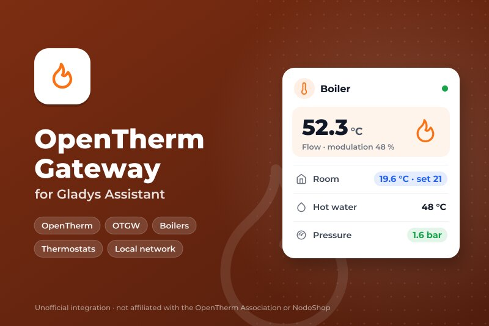
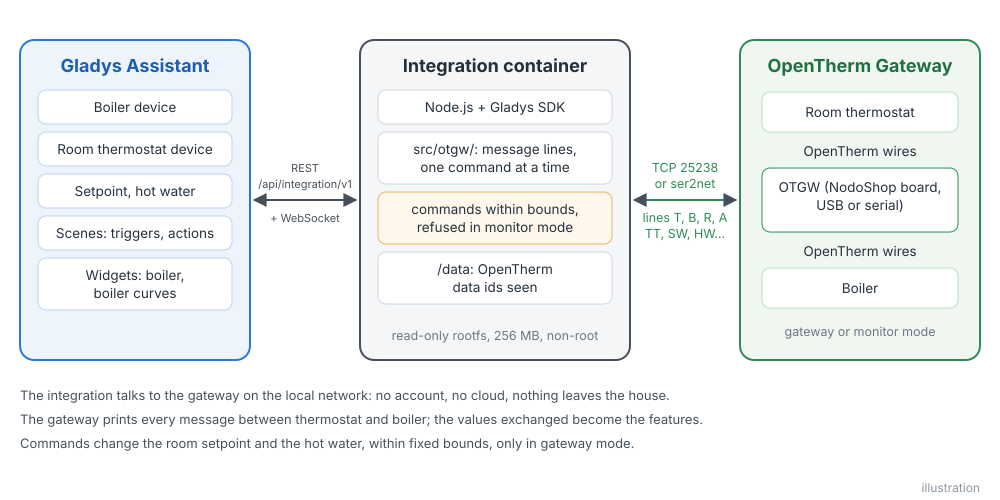
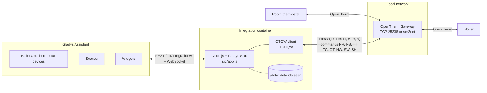
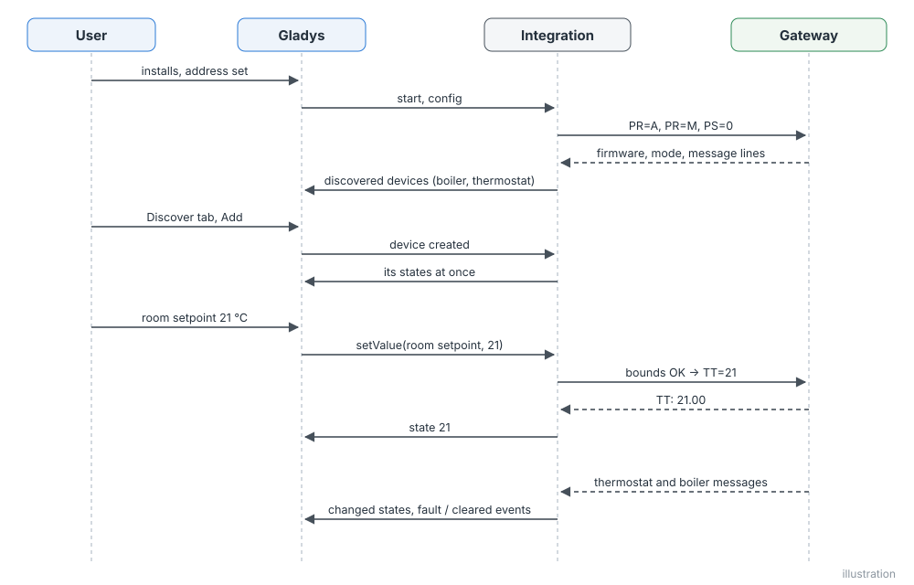
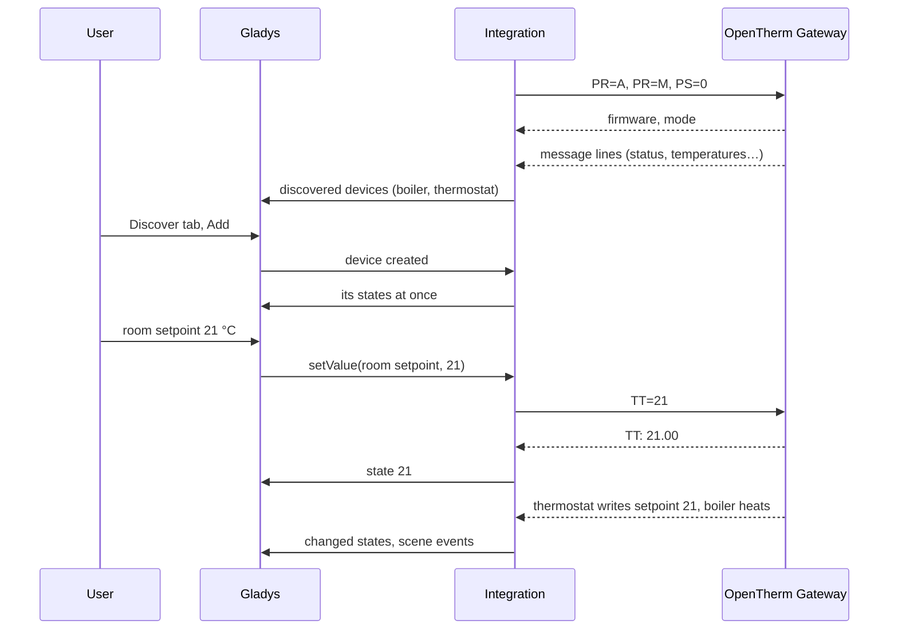
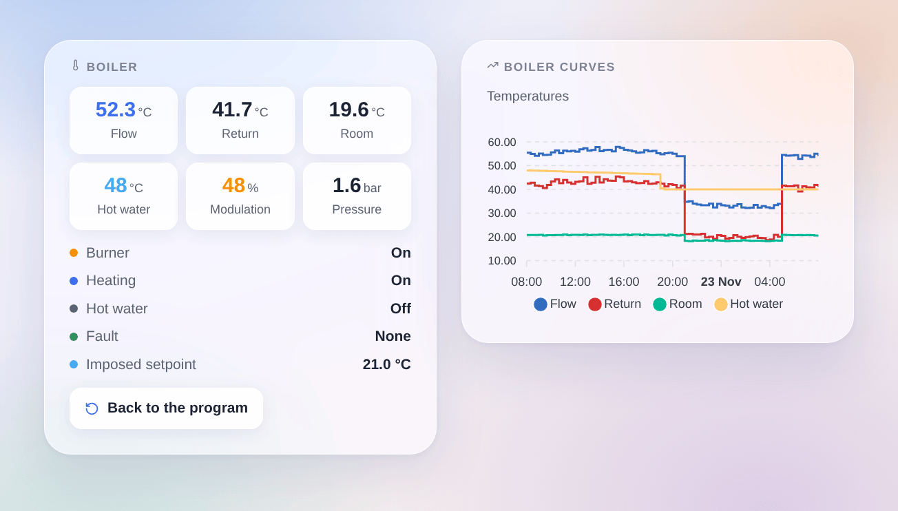
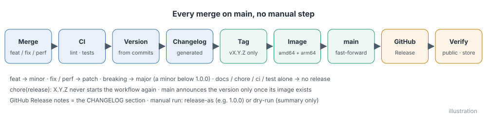

# OpenTherm Gateway for Gladys Assistant

**English** | [Français](README.fr.md) | [Deutsch](README.de.md) | [Español](README.es.md)

[](LICENSE)
[](https://github.com/William-De71/gladys-opentherm-gateway/releases)
[](https://github.com/William-De71/gladys-opentherm-gateway/actions/workflows/release.yml)
[](https://gladysassistant.com)



Your OpenTherm boiler and room thermostat in Gladys Assistant, through the [OpenTherm Gateway](https://otgw.tclcode.com/) (OTGW) on the two wires between them, on your local network. Gladys sees what they say to each other (flame, temperatures, modulation, pressure, faults), can impose a room setpoint, send the outside temperature and drive the hot water. Unofficial, not affiliated with the OpenTherm Association, NodoShop or the boiler brands.

## Features

- **Talks to the gateway over the local network**, through its serial port bridged on TCP: the "Legacy TCP port 25238" of a NodoShop OTGW board (OTGW-firmware), or ser2net for a USB or serial gateway.
- **A boiler device and a room thermostat device**, whose features are the OpenTherm values your thermostat and boiler actually exchange: a boiler without a pressure sensor gets no pressure feature, a new value seen adds its feature.
- **Live values**: the flame, heating and hot water states and the fault reach Gladys at once; the temperatures, modulation and pressure every 15 seconds at most, rounded.
- **Room setpoint from Gladys** (until the next program change of the thermostat, or until cancelled), **hot water target** and **hot water on / off**; refused in monitor mode.
- **Two dashboard widgets**: the boiler at a glance (with a button to give the thermostat its program back), temperature curves.
- **Six scene triggers** (boiler fault, fault cleared, maintenance requested, thermostat disconnected, gateway lost, gateway back) and **six scene actions** (impose or cancel a setpoint, send or stop sending the outside temperature, hot water, maximum flow temperature).
- English, French, German and Spanish.

## How it works





**Protocol.** The gateway prints one line per OpenTherm message: a letter (`T` thermostat, `B` boiler, `R` / `A` a request or an answer the gateway changed) and the 4 bytes of the message in hexadecimal (`B40193480`: the boiler answers that the flow temperature is 52.5 °C). It accepts commands of two letters (`TT=20.5`) and answers `TT: 20.50`, or an error code (`NG`, `SE`, `BV`, `OR`…). At each connection the integration reads the firmware (`PR=A`), the mode (`PR=M`: gateway or monitor) and asks for one line per message (`PS=0`).

**Discovery.** The OpenTherm data ids answered by the boiler or written by the thermostat (status, flow temperature, modulation, pressure, room temperature…) make the features of the two devices. They are kept in `/data/seen.json`, so a restart does not shrink the devices before the traffic comes back. A data id seen for the first time is offered in the Discover tab ("Update").

**Commands.** The room setpoint uses the remote override of the thermostat (`TT` temporary or `TC` constant, 5–30 °C, steps of 0.5 °C), the hot water target `SW` (35–70 °C) and the hot water on / off `HW`. `SW` and `SH` are kept in the memory of the gateway: the same value is never sent twice, and one change a minute at most.





### Devices and features

| Gladys device                  | Features (when the data id is seen)                                                                                                                                                                                                                                                                                |
| ------------------------------ | ------------------------------------------------------------------------------------------------------------------------------------------------------------------------------------------------------------------------------------------------------------------------------------------------------------------ |
| `boiler:otgw` — Boiler         | flame, heating active, hot water active, fault (on / off), fault details (text), modulation (%), flow, return, hot water, outside and exhaust temperatures, flow temperature asked and maximum (°C), water pressure (bar), burner and pump starts, burner and pump hours; hot water target and on / off (writable) |
| `thermostat:otgw` — Thermostat | room temperature, room setpoint (writable), setpoint imposed by Gladys (on / off)                                                                                                                                                                                                                                  |

Data ids used (OpenTherm 2.2): 0 status, 1 control setpoint, 5 fault flags and code, 9 remote override setpoint, 16 room setpoint, 17 modulation, 18 pressure, 24 room temperature, 25 flow, 26 hot water, 27 outside, 28 return, 33 exhaust, 56 hot water setpoint, 57 maximum flow setpoint, 116–123 starts and hours. External ids: `ext:<selector>:boiler:otgw:<key>`, `ext:<selector>:thermostat:otgw:<key>`.

## Transport

`transports: ["local"]`: the catalogue shows the **local** badge. Nothing leaves the local network: no account, no cloud. Each device publishes **local** while the gateway answers and **unreachable** otherwise; there is no local preference to choose, nor degraded mode.

## Widgets



- **Boiler**: flow, return, room and hot water temperatures, modulation, pressure (the tiles follow the device states live), then the fault, the burner, heating and hot water states, the setpoint imposed by Gladys with a **Back to the program** button, a disconnected thermostat, the monitor mode.
- **Boiler curves**: flow, return, room and hot water temperatures over 24 hours, 3 or 7 days (once the devices are added).

## Scene triggers and actions

| Trigger                   | When                                               | Data                                                                                                                |
| ------------------------- | -------------------------------------------------- | ------------------------------------------------------------------------------------------------------------------- |
| `boiler_fault`            | the fault bit of the boiler goes on                | `oem_fault_code`, `faults`, `low_water_pressure`, `gas_flame_fault`, `air_pressure_fault`, `water_over_temperature` |
| `boiler_fault_cleared`    | the fault bit goes off                             | `oem_fault_code`                                                                                                    |
| `service_requested`       | the boiler sets its maintenance request flag       | `oem_fault_code`                                                                                                    |
| `thermostat_disconnected` | the gateway no longer sees an OpenTherm thermostat | `address`                                                                                                           |
| `gateway_offline`         | no connection to the gateway for 3 minutes         | `address`                                                                                                           |
| `gateway_online`          | the gateway answers again                          | `address`                                                                                                           |

| Action                      | What it does                                                                  | Outputs  |
| --------------------------- | ----------------------------------------------------------------------------- | -------- |
| `set_room_override`         | imposes a room setpoint (5–30 °C), until the next program change or cancelled | `result` |
| `cancel_room_override`      | gives the thermostat its program back                                         | `result` |
| `set_outside_temperature`   | tells the thermostat the outside temperature (−40 to 64 °C)                   | `result` |
| `clear_outside_temperature` | stops doing so                                                                | `result` |
| `set_hot_water`             | hot water on, off, or as the thermostat decides                               | `result` |
| `set_max_flow_temperature`  | maximum flow temperature (20–90 °C, 0 = thermostat), once a minute at most    | `result` |

Examples:

- When the boiler reports a fault → send a message with `{{triggerEvent.data.oem_fault_code}}` and `{{triggerEvent.data.faults}}`.
- When the outdoor sensor of Gladys changes → send the outside temperature, for the weather compensation of the thermostat.
- When everybody leaves → impose 17 °C until cancelled; when someone comes back → give the thermostat its program back.

## Requirements

- Gladys Assistant **5.3.0 or later** (catalog keywords of Gladys 5.3, dashboard widgets and scene triggers and actions of integrations; older instances cannot install the integration).
- An [OpenTherm Gateway](https://otgw.tclcode.com/) wired between an OpenTherm room thermostat and an OpenTherm boiler, reachable on TCP: a NodoShop OTGW board with "Legacy TCP port 25238" turned on in its web page, or a USB / serial gateway shared with ser2net in raw mode.
- For the room setpoint: a thermostat that supports the remote override (most modulating OpenTherm thermostats), and the gateway in gateway mode (`GW=1`).

## Installation

- **From the store**: Integrations → search "OpenTherm" → Install.
- **From the repository URL**: Integrations → Install an integration → paste `https://github.com/William-De71/gladys-opentherm-gateway`.
- **Developer mode**: Integrations → Install an integration → Developer mode, with the manifest of a build (the summary of the "Build and publish image" workflow prints it).

## Configuration

| Field           | Type    | Default     | Meaning                                                                                                            |
| --------------- | ------- | ----------- | ------------------------------------------------------------------------------------------------------------------ |
| `host`          | string  | empty       | IP address or name of the OTGW board or of the ser2net machine (not `localhost`), `:port` and `socket://` accepted |
| `port`          | number  | `25238`     | TCP port of the serial bridge                                                                                      |
| `override_mode` | select  | `temporary` | room setpoint from Gladys: `temporary` (until the next program change, `TT`) or `constant` (until cancelled, `TC`) |
| `language`      | select  | `en`        | language of the device and feature names, of the fault text and of the scene errors                                |
| `debug_logs`    | boolean | `false`     | detailed log: every command sent to the gateway and its answer                                                     |

Button of the configuration page: **Test the gateway** (connects, reads the firmware and the mode, lists the OpenTherm values seen).

## Usage

1. Turn on the TCP serial port of the gateway (OTGW-firmware: "Legacy TCP port 25238"; or ser2net).
2. Install the integration, type the address of the gateway, then press **Test the gateway**.
3. Add the boiler and the thermostat from the **Discover** tab, the widgets to a dashboard, create your scenes.

The user documentation is in [docs/en.md](docs/en.md) ([fr](docs/fr.md), [de](docs/de.md), [es](docs/es.md)).

## Limits

- **Never tested on a real gateway**: everything is tested against a fake gateway on a real local socket that follows the firmware documentation. Feedback welcome, with the lines of the detailed log.
- The values depend on what your thermostat asks the boiler: a value never exchanged never appears (the gateway's "alternative" ids, stored in its memory, are not used).
- One gateway per integration (the OpenTherm protocol identifies neither the thermostat nor the boiler). Ventilation, solar storage and the second heating circuit are not handled.
- The OTGW-firmware may accept only one client on its TCP port: OTmonitor or Home Assistant connected at the same time may take it.

## Local development

```bash
npm install
GLADYS_HOST_API_URL=http://localhost:1443 \
  GLADYS_INTEGRATION_TOKEN=… GLADYS_INTEGRATION_SELECTOR=… \
  OTGW_DATA_DIR=./data DEBUG=gladys-integration-sdk node index.js
```

| Variable                                                                         | Default       | Use                                       |
| -------------------------------------------------------------------------------- | ------------- | ----------------------------------------- |
| `GLADYS_HOST_API_URL`, `GLADYS_INTEGRATION_TOKEN`, `GLADYS_INTEGRATION_SELECTOR` | set by Gladys | connection to the Gladys host API         |
| `OTGW_DATA_DIR`                                                                  | `/data`       | folder of `seen.json`                     |
| `DEBUG`                                                                          | unset         | `gladys-integration-sdk` for the SDK logs |

| Script                            | What it does                                        |
| --------------------------------- | --------------------------------------------------- |
| `npm test`                        | the tests (`node --test`), nothing leaves 127.0.0.1 |
| `npm run lint`                    | ESLint                                              |
| `npm run format` / `format:check` | Prettier                                            |
| `docs/illustrations/render.sh`    | regenerate the widget illustrations                 |
| `scripts/build-cover.sh`          | regenerate `cover.jpg` from `docs/assets/cover.svg` |

## Tests

`npm test` runs the whole integration against the fake Gladys of the SDK and a fake OpenTherm Gateway on a real local socket. Covered: the protocol (message lines, parity bit, replies, error codes, events, f8.8 / s16 / u16), which lines carry a value, the features of the data ids seen, the client (one command at a time, timeouts and 3 tries, `OE`, reconnection), identification, discovery and its saved data ids, sampled and immediate states, every command and its bounds (monitor mode, spacing, same value), scene triggers and actions with their declared data and outputs, the two widgets validated by `validateWidgetContent` and the widget button, the gateway lost and back. The manifest is checked against the code, the translations and the release script. The CI also builds the image and starts it like Gladys does (read-only, 256 MB, no network).

## Release process

Every merge on `main` publishes a release when its commits deserve one, with no manual step:

```mermaid
flowchart LR
  A[merge on main] --> B[CI: Prettier, ESLint,<br/>tests, Docker build]
  B --> C[next version from<br/>Conventional Commits]
  C --> D[CHANGELOG.md section]
  D --> E[commit chore release<br/>+ tag vX.Y.Z]
  E --> F[image :X.Y.Z + :latest<br/>amd64 + arm64]
  F --> G[main moves to<br/>the release commit]
  G --> H[GitHub Release]
  H --> I[verify: anonymous pull,<br/>store validator, topic]
```





- `feat` → minor, `fix` / `perf` → patch, `!` or `BREAKING CHANGE:` → major (a minor below 1.0.0). `docs`, `chore`, `ci`, `test`, `style`, `refactor`, `build` alone publish nothing.
- The pull request title becomes the squash commit, hence the changelog line: write it in English, for the user (`feat(widgets): …`). `pr-title.yml` checks it. Never edit `CHANGELOG.md` by hand.
- The image exists before `main` announces its version (the store indexes `main`).
- 1.0.0 is a manual decision: Actions → Release → Run workflow, `release-as: 1.0.0`. `dry-run` shows the version and the changelog without publishing.
- **Protected branch**: rulesets require a pull request on `main` and lock the `v*` tags; only the maintainer and deploy keys get through. The release pushes with the deploy key of the `release` environment (secret `RELEASE_DEPLOY_KEY`, `main` only): a run from another branch never gets it. `build.yml` and `github-release.yml` do not start on a tag: the release calls them, or run them by hand (Actions → Run workflow, with `version` for the image) to finish a release.
- After the first release, make the package public if needed: Package settings → Change visibility → Public.

## Troubleshooting

- **"The gateway does not answer"**: check the address and the port; on a NodoShop board, turn on "Legacy TCP port 25238"; `localhost` does not work from the integration container; OTmonitor or another program may hold the only connection.
- **"Something answers, but not an OpenTherm Gateway"**: wrong port (the web page on 80, the telnet log on 23), or ser2net not in raw mode.
- **"Waiting for the OpenTherm traffic"**: the thermostat is not wired to the gateway, the boiler is off, or the thermostat is an on/off one (not OpenTherm).
- **"monitor mode"**: the gateway only listens; switch it to gateway mode (`GW=1`, from OTmonitor or the OTGW web page) to change settings.
- **The setpoint comes back**: the thermostat does not support the remote override, or a temporary setpoint ended at its next program change (choose "until cancelled").
- **A value is missing**: your thermostat never asks the boiler for it.
- Logs: the Logs tab of the integration. They always say when the gateway is lost (with the reason), what was found and each command accepted; tick **Detailed log** to also see every command and its answer. `DEBUG=gladys-integration-sdk` for the SDK details.

## Contributing

Issues and pull requests are welcome. Run `npm run format:check`, `npm run lint` and `npm test`, write the pull request title as a Conventional Commit, and run `docs/illustrations/render.sh` after any change to a widget content. Never change an existing feature key or its Gladys fields. When a real installation behaves differently, add its lines (detailed log) to the tests first, then fix the code.

## Security

See [SECURITY.md](SECURITY.md). The serial port of the gateway on TCP has no authentication: keep it on a trusted network, never exposed to the Internet. The integration only sends the commands it documents, with checked values. `/data` keeps the list of data ids seen only.

## License

[Apache License 2.0](LICENSE), see also [NOTICE](NOTICE). The client was written for this project from the firmware documentation of the OpenTherm Gateway (Schelte Bron) and the OpenTherm 2.2 message layout; no code was copied. OpenTherm is a trademark of the OpenTherm Association; this project is not affiliated with, endorsed or supported by it, by Schelte Bron, NodoShop or any boiler or thermostat brand.
