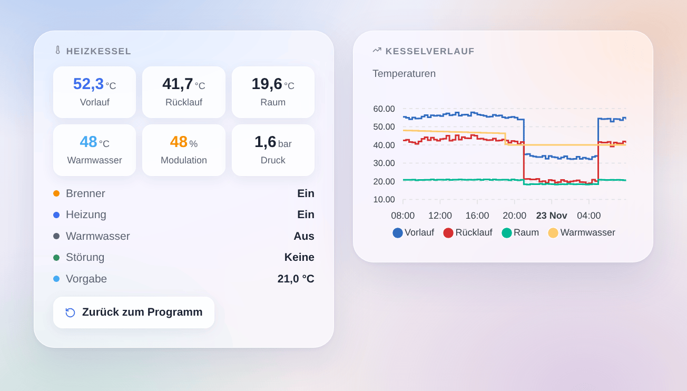

# OpenTherm Gateway

## Überblick

Diese Integration bringt Ihren OpenTherm-Heizkessel und Ihren Raumthermostat über ein [OpenTherm Gateway](https://otgw.tclcode.com/) (OTGW) in Gladys, die Platine an den zwei OpenTherm-Drähten zwischen beiden. Gladys sieht, was sie miteinander austauschen (Flamme, Temperaturen, Modulation, Wasserdruck, Störungen), kann dem Thermostat einen Raum-Sollwert vorgeben, ihm die Außentemperatur senden und das Warmwasser steuern. Alles bleibt in Ihrem lokalen Netzwerk.

Inoffizielle Integration, nicht mit der OpenTherm Association, NodoShop oder den Kessel- und Thermostatmarken verbunden.

## Voraussetzungen

- Gladys Assistant 5.3.0 oder neuer.
- Ein OpenTherm Gateway zwischen einem OpenTherm-Raumthermostat und einem OpenTherm-Kessel.
- Seine serielle Schnittstelle im Netzwerk erreichbar: auf einer NodoShop-OTGW-Platine **Legacy TCP port 25238** auf ihrer Webseite einschalten; bei einem USB- oder seriellen Gateway die Schnittstelle mit ser2net im raw-Modus freigeben.
- Um den Raum-Sollwert aus Gladys zu ändern: ein Thermostat mit Fernübersteuerung (die meisten modulierenden OpenTherm-Thermostate) und das Gateway im Gateway-Modus (`GW=1`), nicht im Monitor-Modus.

## Konfiguration

### Gateway

- **Adresse des Gateways**: die IP-Adresse oder der Name der OTGW-Platine oder des Rechners mit ser2net. `localhost` funktioniert nicht: Gladys führt die Integration in einem eigenen Container aus.
- **TCP-Port**: 25238 auf einer NodoShop-Platine, sonst der Port von ser2net.
- Drücken Sie **Gateway testen**: es zeigt die Firmware des Gateways, seinen Modus und die bereits gesehenen OpenTherm-Werte. Wenn noch keiner gesehen wurde, prüfen Sie, ob der Thermostat am Gateway angeschlossen und der Kessel an ist.

### Sollwert und Sprache

- **In Gladys gesetzter Sollwert**: bis zur nächsten Programmänderung des Thermostats oder bis zur Aufhebung.
- **Sprache der Namen und Texte**: Gladys teilt Integrationen die Sprache der Benutzer nicht mit; wählen Sie die der Geräte- und Funktionsnamen und der Fehlermeldungen.
- **Ausführliches Log**: schreibt jeden an das Gateway gesendeten Befehl und seine Antwort, um ein Problem zu untersuchen.

## Verwendung

### Geräte

Fügen Sie im Tab **Suche** den **Heizkessel** und den **Raumthermostat** hinzu. Ihre Funktionen sind die OpenTherm-Werte, die Ihr Thermostat und Ihr Kessel wirklich austauschen: Flamme, Heiz- und Warmwasserbetrieb, Störung und ihre Details, Modulation, Vorlauf-, Rücklauf-, Warmwasser-, Außen- und Abgastemperatur, Wasserdruck, Starts und Stunden von Brenner und Pumpen, Raumtemperatur und Raum-Sollwert. Wenn ein neuer Wert erscheint (manche Thermostate fragen einige Werte nur ab und zu ab), drücken Sie im Tab Suche auf **Aktualisieren**.

Sie können den **Raum-Sollwert** (5 bis 30 °C) und die **Warmwasser-Solltemperatur** (35 bis 70 °C, höchstens einmal pro Minute: das Gateway hält sie in seinem Speicher) ändern und das **Warmwasser** ein- oder ausschalten.

### Widgets

- **Heizkessel**: Vorlauf-, Rücklauf-, Raum- und Warmwassertemperatur, Modulation, Druck, dann die Störung, Brenner, Heizung und Warmwasser, und der von Gladys vorgegebene Sollwert mit einer Schaltfläche **Zurück zum Programm**.
- **Kesselverlauf**: Vorlauf-, Rücklauf-, Raum- und Warmwassertemperatur über 24 Stunden, 3 oder 7 Tage.

### Szenen

Auslöser: der Kessel meldet eine Störung (mit Code und den Flags Wasserdruck zu niedrig, Gas oder Flamme, Luftdruck, Wasser zu heiß), die Störung ist behoben, der Kessel fordert Wartung an, der Thermostat ist getrennt, das Gateway antwortet nicht mehr, das Gateway antwortet wieder.

Aktionen: Raum-Sollwert vorgeben, Thermostat wieder seinem Programm folgen lassen, Außentemperatur senden, nicht mehr senden, Warmwasser einstellen (ein, aus, wie der Thermostat entscheidet), maximale Vorlauftemperatur einstellen.

Beispiele:

- Wenn der Kessel eine Störung meldet → mir eine Nachricht mit dem Störungscode senden.
- Wenn sich der Außentemperaturfühler ändert → die Außentemperatur an den Thermostat senden.
- Wenn alle gehen → 17 °C bis zur Aufhebung vorgeben; wenn jemand zurückkommt → den Thermostat wieder seinem Programm folgen lassen.

## Fehlerbehebung

- **Das Gateway antwortet nicht**: Adresse und Port prüfen und ob die serielle TCP-Schnittstelle eingeschaltet ist. OTmonitor oder ein anderes Programm am selben Port kann die einzige Verbindung belegen.
- **Etwas antwortet, aber kein OpenTherm Gateway**: falscher Port (die Webseite liegt auf 80, das Telnet-Log auf 23) oder ser2net nicht im raw-Modus.
- **Monitor-Modus**: das Gateway hört nur zu; stellen Sie es aus OTmonitor oder der OTGW-Webseite auf den Gateway-Modus (`GW=1`).
- **Der Sollwert springt zurück**: der Thermostat unterstützt die Fernübersteuerung nicht, oder ein vorübergehender Sollwert endete bei der nächsten Programmänderung.
- **Ein Wert fehlt**: Ihr Thermostat fragt ihn beim Kessel nie ab.
- Sehen Sie im Tab **Logs** der Integration nach; schalten Sie **Ausführliches Log** ein, um jeden Befehl und seine Antwort zu sehen, und hängen Sie diese Zeilen an ein Issue auf GitHub.
