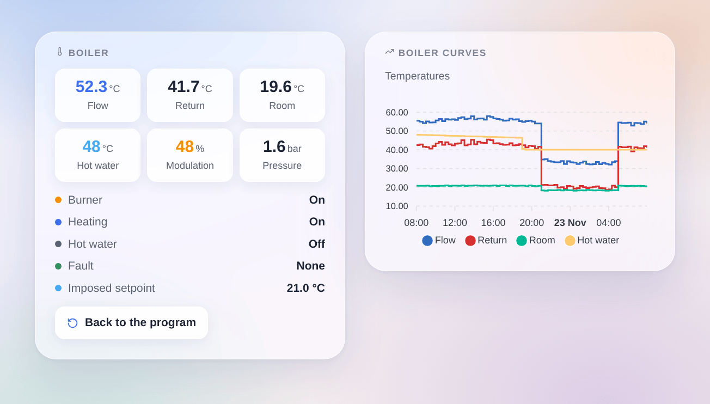

# OpenTherm Gateway

## Overview

This integration brings your OpenTherm boiler and room thermostat into Gladys through an [OpenTherm Gateway](https://otgw.tclcode.com/) (OTGW), the board that sits on the two OpenTherm wires between them. Gladys sees what they say to each other (flame, temperatures, modulation, water pressure, faults), can impose a room setpoint on the thermostat, send it the outside temperature and drive the hot water. Everything stays on your local network.

Unofficial integration, not affiliated with the OpenTherm Association, NodoShop or the boiler and thermostat brands.

## Requirements

- Gladys Assistant 5.3.0 or later.
- An OpenTherm Gateway wired between an OpenTherm room thermostat and an OpenTherm boiler.
- Its serial port reachable on the network: on a NodoShop OTGW board, turn on **Legacy TCP port 25238** in its web page; on a USB or serial gateway, share the port with ser2net in raw mode.
- To change the room setpoint from Gladys: a thermostat that supports the remote override (most modulating OpenTherm thermostats) and the gateway in gateway mode (`GW=1`), not monitor mode.

## Configuration

### Gateway

- **Address of the gateway**: the IP address or the name of the OTGW board, or of the machine running ser2net. `localhost` does not work: Gladys runs the integration in its own container.
- **TCP port**: 25238 on a NodoShop board, the port of ser2net otherwise.
- Press **Test the gateway**: it shows the firmware of the gateway, its mode, and the OpenTherm values already seen. If none is seen yet, check that the thermostat is wired to the gateway and the boiler is on.

### Setpoint and language

- **Setpoint set from Gladys**: until the next program change of the thermostat, or until cancelled.
- **Language of the names and texts**: Gladys does not tell integrations the language of its users; choose the one of the device and feature names and of the error messages.
- **Detailed log**: writes every command sent to the gateway and its answer, to look into a problem.

## Usage

### Devices

In the **Discover** tab, add the **Boiler** and the **Room thermostat**. Their features are the OpenTherm values your thermostat and your boiler actually exchange: flame, heating and hot water active, fault and its details, modulation, flow, return, hot water, outside and exhaust temperatures, water pressure, burner and pump starts and hours, room temperature and setpoint. When a new value shows up (a thermostat asks for some values only from time to time), press **Update** in the Discover tab.

You can change the **room setpoint** (5 to 30 °C), the **hot water target** (35 to 70 °C, at most once a minute: the gateway keeps it in its memory) and turn the **hot water** on or off.

### Widgets

- **Boiler**: flow, return, room and hot water temperatures, modulation, pressure, then the fault, the burner, heating and hot water states, and the setpoint imposed by Gladys with a **Back to the program** button.
- **Boiler curves**: flow, return, room and hot water temperatures over 24 hours, 3 or 7 days.

### Scenes

Triggers: the boiler reports a fault (with its code and the flags low water pressure, gas or flame, air pressure, water too hot), the fault is cleared, the boiler asks for maintenance, the thermostat is disconnected, the gateway stops answering, the gateway answers again.

Actions: impose a room setpoint, give the thermostat its program back, send the outside temperature, stop sending it, set the hot water (on, off, as the thermostat decides), set the maximum flow temperature.

Examples:

- When the boiler reports a fault → send me a message with the fault code.
- When the outdoor temperature sensor changes → send the outside temperature to the thermostat.
- When everybody leaves → impose 17 °C until cancelled; when someone comes back → give the thermostat its program back.

## Troubleshooting

- **The gateway does not answer**: check the address and the port, and that the TCP serial port is turned on. OTmonitor or another program connected to the same port may hold the only connection.
- **Something answers, but not an OpenTherm Gateway**: wrong port (the web page is on 80, the telnet log on 23), or ser2net not in raw mode.
- **Monitor mode**: the gateway only listens; switch it to gateway mode (`GW=1`) from OTmonitor or the OTGW web page.
- **The setpoint comes back**: the thermostat does not support the remote override, or a temporary setpoint ended at its next program change.
- **A value is missing**: your thermostat never asks the boiler for it.
- Look at the **Logs** tab of the integration; turn on **Detailed log** to see every command and its answer, and attach these lines to an issue on GitHub.
