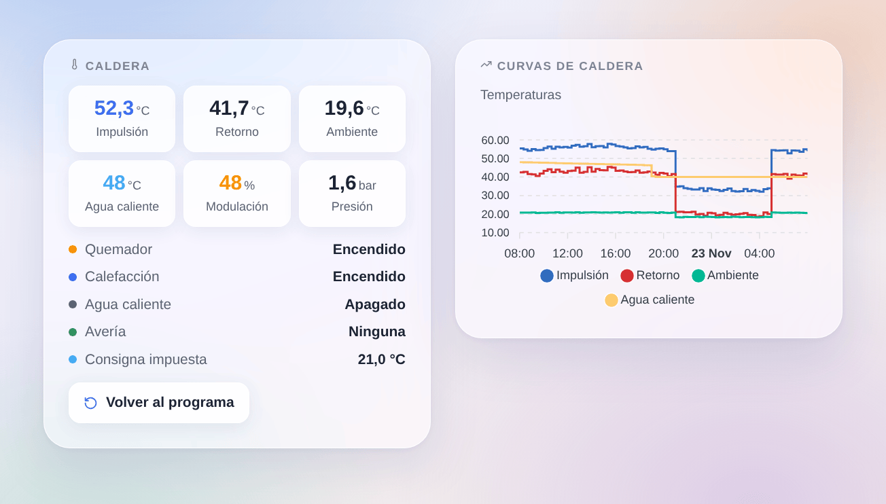

# OpenTherm Gateway

## Presentación

Esta integración lleva su caldera y su termostato de ambiente OpenTherm a Gladys gracias a un [OpenTherm Gateway](https://otgw.tclcode.com/) (OTGW), la placa que se conecta a los dos cables OpenTherm que los unen. Gladys ve lo que se dicen (llama, temperaturas, modulación, presión del agua, averías), puede imponer una consigna ambiente al termostato, enviarle la temperatura exterior y controlar el agua caliente. Todo se queda en su red local.

Integración no oficial, sin relación con la OpenTherm Association, NodoShop ni las marcas de calderas y termostatos.

## Requisitos

- Gladys Assistant 5.3.0 o posterior.
- Un OpenTherm Gateway conectado entre un termostato de ambiente OpenTherm y una caldera OpenTherm.
- Su puerto serie accesible en la red: en una placa OTGW de NodoShop, active **Legacy TCP port 25238** en su página web; en una pasarela USB o serie, comparta el puerto con ser2net en modo raw.
- Para cambiar la consigna ambiente desde Gladys: un termostato que admita la anulación remota (la mayoría de los termostatos OpenTherm modulantes) y la pasarela en modo pasarela (`GW=1`), no en modo monitor.

## Configuración

### Pasarela

- **Dirección de la pasarela**: la dirección IP o el nombre de la placa OTGW, o del equipo con ser2net. `localhost` no funciona: Gladys ejecuta la integración en su propio contenedor.
- **Puerto TCP**: 25238 en una placa NodoShop; si no, el puerto de ser2net.
- Pulse **Probar la pasarela**: muestra el firmware de la pasarela, su modo y los valores OpenTherm ya vistos. Si aún no se ve ninguno, compruebe que el termostato está conectado a la pasarela y que la caldera está encendida.

### Consigna e idioma

- **Consigna fijada desde Gladys**: hasta el próximo cambio de programa del termostato, o hasta que se anule.
- **Idioma de los nombres y textos**: Gladys no indica a las integraciones el idioma de sus usuarios; elija el de los nombres de dispositivos y funciones y de los mensajes de error.
- **Registro detallado**: escribe cada comando enviado a la pasarela y su respuesta, para estudiar un problema.

## Uso

### Dispositivos

En la pestaña **Búsqueda**, añada la **Caldera** y el **Termostato**. Sus funciones son los valores OpenTherm que su termostato y su caldera intercambian de verdad: llama, calefacción y agua caliente activas, avería y su detalle, modulación, temperaturas de impulsión, retorno, agua caliente, exterior y de humos, presión del agua, arranques y horas del quemador y de las bombas, temperatura y consigna ambiente. Cuando aparece un valor nuevo (algunos termostatos piden ciertos valores solo de vez en cuando), pulse **Actualizar** en la pestaña Búsqueda.

Puede cambiar la **consigna ambiente** (5 a 30 °C), la **consigna de agua caliente** (35 a 70 °C, como mucho una vez por minuto: la pasarela la guarda en su memoria) y encender o apagar el **agua caliente**.

### Widgets

- **Caldera**: temperaturas de impulsión, retorno, ambiente y agua caliente, modulación, presión, luego la avería, el quemador, la calefacción y el agua caliente, y la consigna impuesta por Gladys con un botón **Volver al programa**.
- **Curvas de caldera**: temperaturas de impulsión, retorno, ambiente y agua caliente en 24 horas, 3 o 7 días.

### Escenas

Disparadores: la caldera indica una avería (con su código y los indicadores presión de agua baja, gas o llama, presión de aire, agua demasiado caliente), la avería desaparece, la caldera pide mantenimiento, el termostato está desconectado, la pasarela deja de responder, la pasarela vuelve a responder.

Acciones: imponer una consigna ambiente, devolver el termostato a su programa, enviar la temperatura exterior, dejar de enviarla, ajustar el agua caliente (encendida, apagada, según el termostato), ajustar la temperatura de impulsión máxima.

Ejemplos:

- Cuando la caldera indica una avería → enviarme un mensaje con el código de avería.
- Cuando cambia la sonda de temperatura exterior → enviar la temperatura exterior al termostato.
- Cuando todos se van → imponer 17 °C hasta que se anule; cuando alguien vuelve → devolver el termostato a su programa.

## Solución de problemas

- **La pasarela no responde**: compruebe la dirección, el puerto y que el puerto serie TCP está activado. OTmonitor u otro programa conectado al mismo puerto puede ocupar la única conexión.
- **Algo responde, pero no un OpenTherm Gateway**: puerto equivocado (la página web está en el 80, el registro telnet en el 23), o ser2net no está en modo raw.
- **Modo monitor**: la pasarela solo escucha; pásela a modo pasarela (`GW=1`) desde OTmonitor o la página web del OTGW.
- **La consigna vuelve**: el termostato no admite la anulación remota, o una consigna temporal terminó en el siguiente cambio de programa.
- **Falta un valor**: su termostato nunca lo pide a la caldera.
- Consulte la pestaña **Logs** de la integración; active **Registro detallado** para ver cada comando y su respuesta, y adjunte esas líneas a una issue en GitHub.
