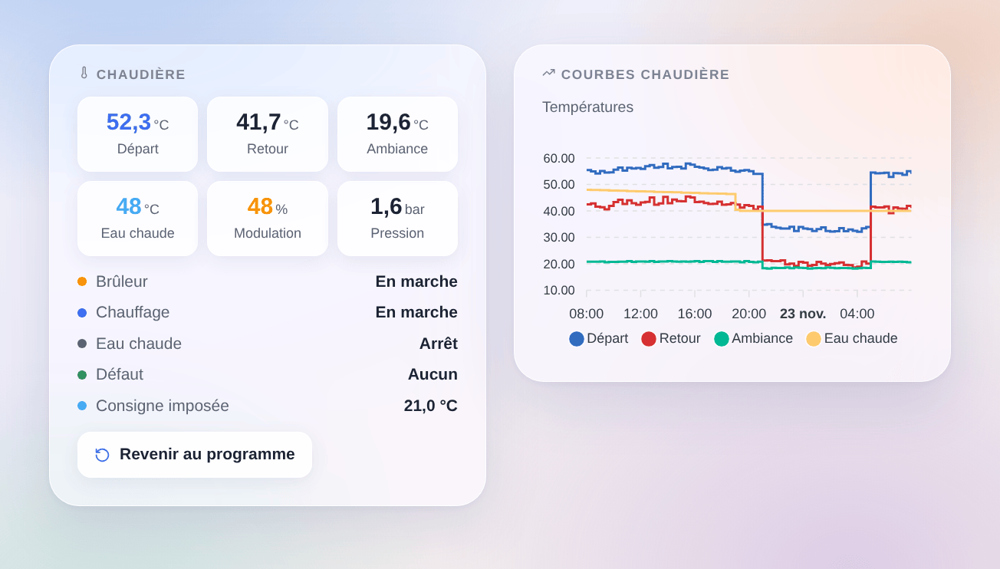

# OpenTherm Gateway

## Présentation

Cette intégration amène votre chaudière et votre thermostat d’ambiance OpenTherm dans Gladys grâce à une [OpenTherm Gateway](https://otgw.tclcode.com/) (OTGW), la carte qui se branche sur les deux fils OpenTherm qui les relient. Gladys voit ce qu’ils se disent (flamme, températures, modulation, pression d’eau, défauts), peut imposer une consigne ambiante au thermostat, lui envoyer la température extérieure et piloter l’eau chaude. Tout reste sur votre réseau local.

Intégration non officielle, sans lien avec l’OpenTherm Association, NodoShop ni les marques de chaudières et de thermostats.

## Prérequis

- Gladys Assistant 5.3.0 ou plus récent.
- Une OpenTherm Gateway branchée entre un thermostat d’ambiance OpenTherm et une chaudière OpenTherm.
- Son port série joignable sur le réseau : sur une carte OTGW NodoShop, activez **Legacy TCP port 25238** dans sa page web ; sur une passerelle USB ou série, partagez le port avec ser2net en mode raw.
- Pour changer la consigne ambiante depuis Gladys : un thermostat qui accepte la dérogation à distance (la plupart des thermostats OpenTherm modulants) et la passerelle en mode passerelle (`GW=1`), pas en mode moniteur.

## Configuration

### Passerelle

- **Adresse de la passerelle** : l’adresse IP ou le nom de la carte OTGW, ou de la machine où tourne ser2net. `localhost` ne fonctionne pas : Gladys fait tourner l’intégration dans son propre conteneur.
- **Port TCP** : 25238 sur une carte NodoShop, sinon le port de ser2net.
- Appuyez sur **Tester la passerelle** : il affiche le firmware de la passerelle, son mode et les valeurs OpenTherm déjà vues. Si aucune n’est vue, vérifiez que le thermostat est raccordé à la passerelle et que la chaudière est allumée.

### Consigne et langue

- **Consigne fixée depuis Gladys** : jusqu’au prochain changement de programme du thermostat, ou jusqu’à annulation.
- **Langue des noms et des textes** : Gladys n’indique pas aux intégrations la langue de ses utilisateurs ; choisissez celle des noms des appareils et des fonctionnalités et des messages d’erreur.
- **Journal détaillé** : écrit chaque commande envoyée à la passerelle et sa réponse, pour étudier un problème.

## Utilisation

### Appareils

Dans l’onglet **Découverte**, ajoutez la **Chaudière** et le **Thermostat d’ambiance**. Leurs fonctionnalités sont les valeurs OpenTherm que votre thermostat et votre chaudière échangent réellement : flamme, chauffage et eau chaude en cours, défaut et son détail, modulation, températures de départ, retour, eau chaude, extérieure et des fumées, pression d’eau, démarrages et heures du brûleur et des pompes, température et consigne ambiantes. Quand une nouvelle valeur apparaît (certains thermostats ne demandent des valeurs que de temps en temps), appuyez sur **Mettre à jour** dans l’onglet Découverte.

Vous pouvez changer la **consigne ambiante** (5 à 30 °C), la **consigne d’eau chaude** (35 à 70 °C, au plus une fois par minute : la passerelle la garde en mémoire) et mettre l’**eau chaude** en marche ou à l’arrêt.

### Widgets

- **Chaudière** : températures de départ, retour, ambiante et eau chaude, modulation, pression, puis le défaut, l’état du brûleur, du chauffage et de l’eau chaude, et la consigne imposée par Gladys avec un bouton **Revenir au programme**.
- **Courbes chaudière** : températures de départ, retour, ambiante et eau chaude sur 24 heures, 3 ou 7 jours.

### Scènes

Déclencheurs : la chaudière signale un défaut (avec son code et les indicateurs pression d’eau basse, gaz ou flamme, pression d’air, eau trop chaude), le défaut disparaît, la chaudière demande un entretien, le thermostat est déconnecté, la passerelle ne répond plus, la passerelle répond de nouveau.

Actions : imposer une consigne ambiante, rendre la main au programme du thermostat, envoyer la température extérieure, arrêter de l’envoyer, régler l’eau chaude (marche, arrêt, selon le thermostat), régler la température de départ maximale.

Exemples :

- Quand la chaudière signale un défaut → m’envoyer un message avec le code de défaut.
- Quand la sonde de température extérieure change → envoyer la température extérieure au thermostat.
- Quand tout le monde part → imposer 17 °C jusqu’à annulation ; quand quelqu’un rentre → rendre la main au programme du thermostat.

## Dépannage

- **La passerelle ne répond pas** : vérifiez l’adresse, le port et que le port série TCP est activé. OTmonitor ou un autre programme connecté au même port peut occuper la seule connexion.
- **Quelque chose répond, mais pas une OpenTherm Gateway** : mauvais port (la page web est sur 80, le journal telnet sur 23), ou ser2net pas en mode raw.
- **Mode moniteur** : la passerelle ne fait qu’écouter ; passez-la en mode passerelle (`GW=1`) depuis OTmonitor ou la page web de l’OTGW.
- **La consigne revient** : le thermostat n’accepte pas la dérogation à distance, ou une consigne temporaire a pris fin au changement de programme suivant.
- **Une valeur manque** : votre thermostat ne la demande jamais à la chaudière.
- Consultez l’onglet **Journaux** de l’intégration ; activez **Journal détaillé** pour voir chaque commande et sa réponse, et joignez ces lignes à une issue sur GitHub.
